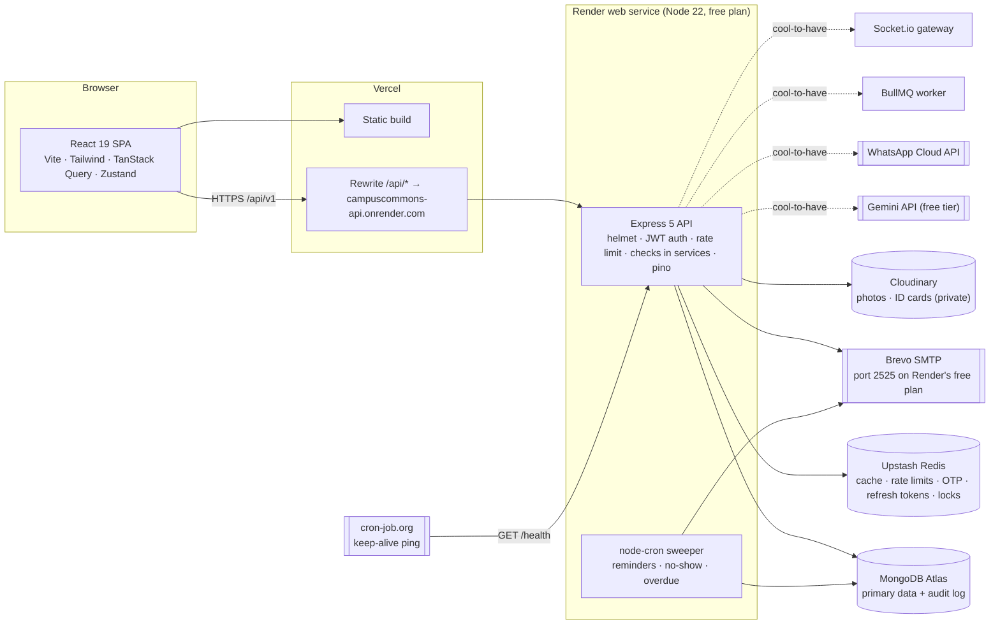
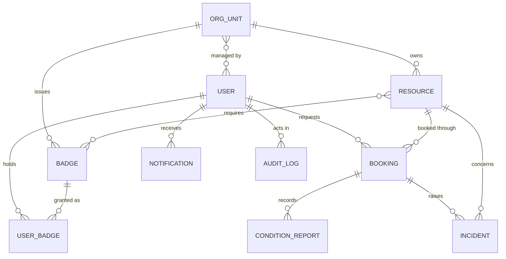
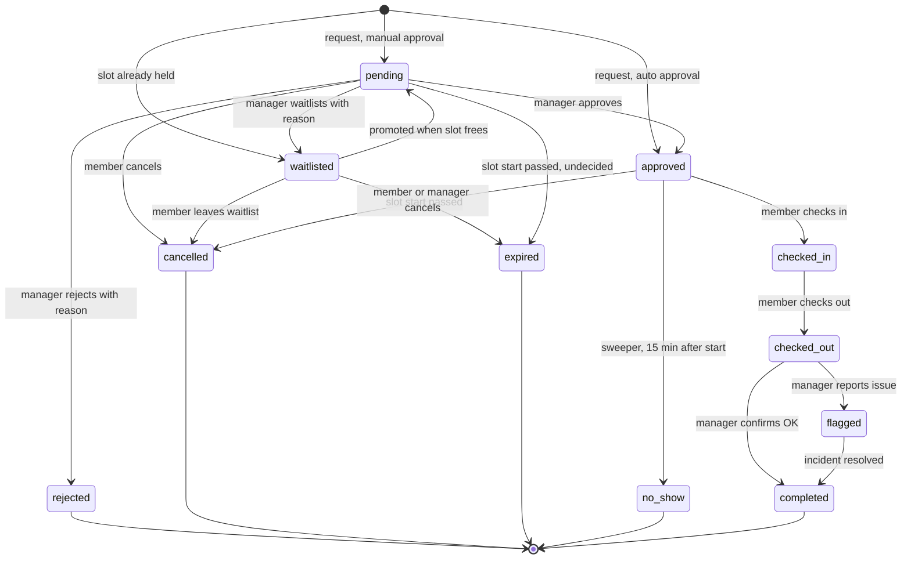
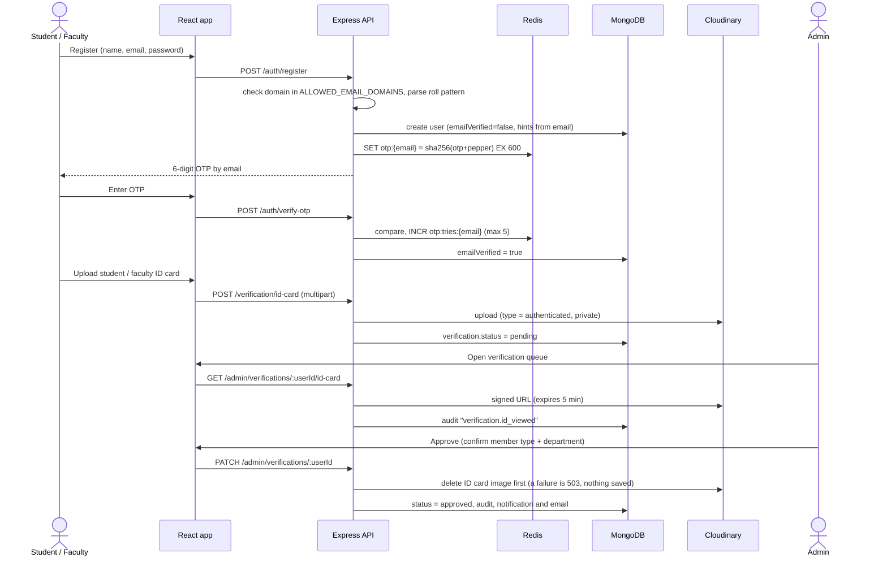

# ShareX: System Architecture

> **ShareX** (working name) lets departments and central facilities at **NIT Jamshedpur** share underused spaces, equipment and computing resources with verified students and faculty.
>
> Stack: **MongoDB · Express · React · Node.js · Tailwind CSS**, plus Redis. As built: Express 5, Mongoose 9, React 19, Vite 8, Tailwind 4.
>
> It is built for a 48-hour hackathon. It is an independent prototype and is not affiliated with the institute: no official logo or branding is used.

Related docs: [`backend.md`](./backend.md) · [`frontend.md`](./frontend.md) · [`api.md`](./api.md) · [`deploy.md`](./deploy.md) · [`progress.md`](./progress.md)

---

## Implementation status (30 Oct 2026)

This file is the design. Each major section now opens with a **Status:** line, checked against the code on 29 Oct 2026 (and on 30 Oct for the five features added that day: §6.2, §8, §10, §11, §15, §16), and rows are marked where their status differs from the section's.

- **Built:** the whole MVP lifecycle (§1.4): sign-up with an email code, ID-card verification, resources, badges, the 12-rule eligibility engine, bookings under a Redis lock, the FIFO waitlist, handovers, return confirmation, incidents, in-app notifications, the audit log and timeline, and the 5-minute sweeper. Five cool-to-haves since 30 Oct: the signed QR booking pass and the unit's scanner, AI search and the AI photo comparison (Gemini, under the §15.2 quota), the on-device ID-card check (§15.3), and the public How it works page with a guided tour. It is deployed on Vercel, Render (free plan), MongoDB Atlas, Upstash Redis, Cloudinary and Brevo SMTP.
- **Partial:** RBAC (enforced, but no API to change roles or suspend users), email notifications (sign-up codes and ID decisions only), and input validation (hand-written checks in the services instead of Zod, and no HTML stripping).
- **Not built:** the other cool-to-haves (the rest of §6.2, the AI incident summary in §15, the §17 upgrades), the audit hash chain, admin pages for users and org units, database transactions, badge revoke, and a shared secret between Vercel and Render.
- **Changed from the design:** routes call the services directly, with no `controllers/`, `validators/` or `validate()` middleware (§3). Tests use `node:test`: server 356 pass and 2 skip without `TEST_MONGODB_URI` (all 827 pass with a local MongoDB); client 374 pass (30 Oct).
- **Legend:** ✅ built · 🟡 partial · ❌ not built.
- **More:** history and decisions in [`progress.md`](./progress.md); the API as built in [`api.md`](./api.md), which wins where this file disagrees; the deployment as done in [`deploy.md`](./deploy.md).

---

## 1. Product summary

### 1.1 Use case

NIT Jamshedpur (Adityapur, Jamshedpur, Jharkhand 831014) has 12 academic departments, the Design and Innovation Centre, and several central facilities. Equipment and rooms owned by one unit often sit idle while students in another unit cannot get access. Typical examples are a 3D printer in the DIC, an oscilloscope in ECE, a GPU workstation in the Computer Centre, or a lathe in the Central Workshop. Buying or renting such items privately is too expensive for a student or a student startup.

ShareX is a **campus-internal** sharing platform:

- Only people with an `@nitjsr.ac.in` email can join.
- Every account is confirmed by a human who checks a **student or faculty ID card**.
- Every resource carries its own eligibility rules (training badges, member type, department), approval mode and fair-usage limits.
- Every booking moves through an auditable lifecycle, from request to return confirmation.

### 1.2 Institution data (taken from the public site nitjsr.ac.in)

**Status:** ✅ All 18 units below are seeded (`server/scripts/seedData.js`, `npm run seed`), with fictional badges, resources and demo users.

These become the seeded **OrgUnits**, the owners of resources:

| Type               | OrgUnits (code)                                                                                                                                                                                                                                                                                       |
| ------------------ | ----------------------------------------------------------------------------------------------------------------------------------------------------------------------------------------------------------------------------------------------------------------------------------------------------- |
| Departments        | CSE (`cse`), ECE (`ece`), Electrical (`ee`), Mechanical (`mech`), Civil (`civil`), Metallurgical & Materials (`mme`), Production & Industrial (`prod`), Chemistry (`chem`), Physics (`phys`), Mathematics (`maths`), Computer Applications (`mca`), Humanities, Social Sciences & Management (`hssm`) |
| Centres            | Design and Innovation Centre (`dic`; est. 2024, M.Des Product Design), Centre for Innovation and Incubation (`ciic`)                                                                                                                                                                                  |
| Central facilities | Central Workshop (`cw`), Computer Centre (`cc`), Central Library (`lib`), Students' Activities Centre (`sac`)                                                                                                                                                                                         |

The department pages also name these labs in Production & Industrial: CAD/CAM, Advanced Manufacturing & FMS, Non-Traditional Manufacturing, and Industrial Engineering & Ergonomics.

> **Data ethics.** The site's code also contains real staff names and phone numbers. **We use none of them.** Only unit names are reused. All seeded people, roll numbers and inventory are fictional (hackathon rules 9 and 10).

### 1.3 Roles

**Status:** 🟡 All three roles are enforced. An admin can't yet change roles or suspend users through the app: managers are set with `PUT /org-units/:id/managers` (API only, no page), and admins with `npm run grant-admin` (`server/scripts/grant-admin.js`).

| Role        | Who at NIT JSR                                    | Can do                                                                                                                                         |
| ----------- | ------------------------------------------------- | ---------------------------------------------------------------------------------------------------------------------------------------------- |
| **Member**  | Student (UG / PG / Research Scholar) or Faculty   | Browse, check eligibility, request badges, book, check in and out, report incidents, and see their own history                                 |
| **Manager** | Faculty in-charge or lab technician of an OrgUnit | List and edit their unit's resources, grant badges, approve, reject or waitlist requests, run handovers, confirm returns, and handle incidents |
| **Admin**   | Institute-level delegate                          | Verify ID cards, manage OrgUnits and roles, suspend users, resolve escalated incidents, and view the full audit log                            |

A user can hold several roles at once; for example, a faculty member can be both a Member and a Manager. The _owner_ of a resource is its **OrgUnit**. Managers act on the unit's behalf, so ownership does not depend on one person.

### 1.4 The 10-step lifecycle in the system

**Status:** ✅ All 10 steps work end to end with the screens and APIs listed. `npm run golden-path` and `test/integration/goldenPath.test.js` run them in order.

| #   | Lifecycle step (problem statement)               | Screen                                            | API                                                                        | Booking state                           |
| --- | ------------------------------------------------ | ------------------------------------------------- | -------------------------------------------------------------------------- | --------------------------------------- |
| 1   | Owner lists a resource and its conditions        | Manage → New resource                             | `POST /resources`                                                          | —                                       |
| 2   | User discovers it and checks eligibility         | Explore → Resource detail                         | `GET /resources`, `GET /resources/:id/eligibility`                         | —                                       |
| 3   | User submits a booking request                   | Resource detail → Book                            | `POST /bookings/check`, `POST /bookings`                                   | `pending` / `approved` / `waitlisted`   |
| 4   | System verifies requirements                     | (automatic)                                       | Eligibility engine inside `POST /bookings`                                 | Rule results saved on the booking       |
| 5   | Owner or manager reviews                         | Manage → Requests                                 | `GET /bookings/manage`                                                     | `pending`                               |
| 6   | Approved, rejected or waitlisted                 | Manage → Requests                                 | `POST /bookings/:id/approve \| reject \| waitlist`                         | `approved` / `rejected` / `waitlisted`  |
| 7   | User checks in and records the initial condition | Booking → Check in                                | `POST /bookings/:id/check-in`                                              | `checked_in`                            |
| 8   | Return and final condition recorded              | Booking → Check out, then Manage → Confirm return | `POST /bookings/:id/check-out`, `POST /bookings/:id/confirm-return`        | `checked_out` → `completed` / `flagged` |
| 9   | Delay, damage or conflict reported and handled   | Incident form / Manage → Incidents                | `POST /incidents`, `POST /incidents/:id/resolve`, plus the overdue sweeper | `flagged` → `completed`                 |
| 10  | Both parties see the full history                | Booking → Timeline; Admin → Audit                 | `GET /bookings/:id/timeline`, `GET /audit`                                 | —                                       |

### 1.5 Judging-criteria coverage

**Status:** 🟡 Every row holds except the two marked.

| Criterion (points)                        | What covers it                                                                                                                                          |
| ----------------------------------------- | ------------------------------------------------------------------------------------------------------------------------------------------------------- |
| Understanding of the problem (15)         | NIT JSR-specific OrgUnits, ID-card verification, per-resource risk levels and badges, and a privacy-aware design                                        |
| Strength of the core solution (20)        | One focused lifecycle; each rejection or waitlist decision states its reason and how to fix it                                                          |
| Working end-to-end product (20)           | Seeded demo accounts, a one-click role switcher, and a scripted golden path (see [`frontend.md` §11](./frontend.md#11-judge-golden-path-demo-script))   |
| Technical depth and reliability (15)      | Input checks in every service (🟡 hand-written, not Zod: §12), Redis locks against double booking, an idempotent cron sweeper, caching, per-user rate limits, and structured logs           |
| Trust, safety and accountability (10)     | Human ID verification, badges, before and after condition reports with photos, incidents with human resolution, and an append-only audit log            |
| Fair allocation and accessibility (10)    | Weekly hour caps, an active-booking cap, a transparent FIFO waitlist, mandatory override reasons, and WCAG-AA UI                                        |
| Originality and real-world potential (10) | Campus-email plus ID verification, explainable eligibility, AI search and an AI photo comparison under a hard quota that send no personal data (§15), an ID-card check that runs on the member's own device, a signed QR booking pass, and NIT JSR-ready seed data |

---

## 2. High-level architecture

**Status:** ✅ The solid lines are deployed as drawn. `client/vercel.json` rewrites `/api/*` to `https://campuscommons-api.onrender.com`, a free Render web service (Node 22, Singapore, `render.yaml`). ❌ Nothing on the dashed lines exists. 🟡 Nothing stops anyone calling the Render URL directly, because Vercel and Render share no secret (§11). Some networks block `*.vercel.app` altogether (§20).



Solid lines are the MVP. Dashed lines are cool-to-have.

**Why each choice:**

- **The `/api` rewrite on Vercel.** The browser sees the API on the same origin as the SPA. That means:
  - the refresh-token cookie is first-party, so `SameSite=Strict` works and Safari's third-party cookie blocking doesn't matter;
  - no CORS preflights are needed in production.
- **One Node process for the API and the cron sweeper.** This is enough for a hackathon. A Redis lock stops the sweeper running twice if a second instance is ever added.
- **Redis is used across the MVP**: rate limits, OTPs, refresh-token allowlist, booking locks and caching. It is _not_ used for queues until BullMQ arrives (cool-to-have). The AI-quota keys exist in code but nothing uses them yet (§15).
- **`/health` is outside `/api`**, so the rewrite doesn't forward it. The keep-alive ping calls the Render URL directly.

---

## 3. Repository layout

**Status:** 🟡 The layout and pipeline below are corrected to match the code. The planned `validators/` and `controllers/` folders and the `validate` and `rbac` middleware were never built. Each router calls its service directly (`server/src/routes/*.js`), and the service checks its own input (`services/params.js`) and scope (`services/access.js`, `engines/stateMachine.js`). There is no `AppError` or `emailPattern` module: errors are `ServiceError`s, and `emailHints()` is in `services/authService.js`.

```
CodeConquerorHackathon/
├── client/                 # React 19 + Vite 8 + Tailwind 4 (see frontend.md); vercel.json: rewrite, CSP, headers
├── server/                 # Express 5 API (see backend.md)
│   ├── src/
│   │   ├── config/         # env checks (hand-written, env.js), db, redis, cloudinary, mailer
│   │   ├── models/         # Mongoose schemas (10 models)
│   │   ├── middleware/     # requestLogger (request id), httpLogger, auth, blockSuspended, rateLimit, errorHandler
│   │   ├── routes/         # express.Router per group → services (no controllers)
│   │   ├── services/       # business logic, input checks (params.js), scope checks (access.js)
│   │   ├── engines/        # pure functions: eligibility, stateMachine, availability
│   │   ├── jobs/           # node-cron sweeper
│   │   └── lib/            # logger, log, serviceError, respond, time (IST), lock, redisKeys, rate-limit store
│   ├── scripts/            # seed (fictional NIT JSR demo data), grant-admin, golden-path, check-redis
│   └── test/               # node:test; MongoDB suites skip without TEST_MONGODB_URI
├── render.yaml             # Render Blueprint for the API
└── docs/                   # these docs
```

Every request passes through the same pipeline:

```
request → requestId → pino-http → helmet → express.json (100 kB) → cookieParser → cors
        → [verifyAuth] → [rate limit] → [blockSuspended] → route → service (input and scope checks) → model
                                                                     ↘ auditService / notifyService / cache invalidation
errors anywhere → errorHandler → { success:false, error, requestId }
```

On auth routes the input check (`checked()` in `routes/auth.js`) runs before `[rate limit]`, because those limiters key on the checked email or role (§11).

Services throw errors that carry `status`, `code` and, where useful, `details` and `headers` (`Retry-After`). The error handler sends them as they are. These errors include `ServiceError` (`lib/serviceError.js`), the booking lock's 503 (`LockUnavailableError`), and the AI quota's 429 and 503 (defined, never thrown: §15).

---

## 4. Domain model

**Status:** ✅ All 10 collections exist as Mongoose models (`server/src/models/`), with `orgUnit` denormalised onto bookings and incidents (§7.3). `auditlogs` is append-only: every update and delete hook on the model throws. ❌ Nothing sets a badge to `revoked` yet.



| Collection         | Purpose                                                                              |
| ------------------ | ------------------------------------------------------------------------------------ |
| `users`            | Identity, roles, member type, department, verification status, strikes               |
| `orgunits`         | Departments, centres and facilities, with their managers                             |
| `resources`        | A listing plus availability, eligibility rules, limits and condition checklist       |
| `badges`           | Training or qualification catalogue (e.g. "3D Printing Basics" issued by DIC)        |
| `userbadges`       | A user's badge requests and grants (`requested → active / rejected / revoked`; ❌ no revoke action sets `revoked`) |
| `bookings`         | Requests and their lifecycle; waitlist entries are bookings with status `waitlisted` |
| `conditionreports` | Check-in, check-out and return-confirmation checklists with photos                   |
| `incidents`        | Damage, delay, misuse, safety or conflict reports, with their human resolution       |
| `notifications`    | In-app notification feed                                                             |
| `auditlogs`        | Append-only record of every important action                                         |

Field-level schemas and indexes are in [`backend.md` §5](./backend.md#5-data-models).

---

## 5. Booking state machine

**Status:** ✅ Built as drawn. One `TRANSITIONS` map (`engines/stateMachine.js`) is applied with a conditional update on the expected status (`services/bookingTransitions.js`), with an audit entry and notifications on every transition. 🟡 Three guards are missing or weak, marked in the table:
- `approve` has no "before start" check;
- a borrower can cancel an `approved` booking after it starts;
- the check-in window and the no-show sweep disagree.



`overdue` is **not a state**. It is a flag (`flags.overdue`) that the sweeper sets on a `checked_in` booking once `end + 15 min` has passed. A flagged booking still follows the normal `checked_out` path.

| From → To                                           | Who                          | Requires                                               | Side effects                                                                                                     |
| --------------------------------------------------- | ---------------------------- | ------------------------------------------------------ | ---------------------------------------------------------------------------------------------------------------- |
| — → `pending` / `approved` / `waitlisted`           | Member                       | All hard eligibility rules pass                        | Eligibility snapshot saved; audit `booking.requested`; notify managers (pending) or member (approved/waitlisted) |
| `pending` → `approved`                              | Manager of the OrgUnit       | Conflict re-check passes. 🟡 No "before start" guard: until the next sweep expires the request (up to 5 min), a manager can approve one whose slot has already started | Audit `booking.approved`; notify member                                                                          |
| `pending` → `rejected`                              | Manager                      | `reason` (required, at most 500 chars; 🟡 no minimum length is enforced) | Audit; notify member; promote waitlist                                                                           |
| `pending` → `waitlisted`                            | Manager                      | `reason`                                               | Audit; notify member with their position; promote the next waitlisted request (never this one)                   |
| `pending` / `approved` / `waitlisted` → `cancelled` | Member (own) or Manager      | `reason` (required for managers, optional for members). 🟡 No time guard: a borrower can cancel an `approved` booking after its start, before the no-show sweep marks it | Audit; notify the other party; promote waitlist                                                                  |
| `waitlisted` → `pending`                            | System                       | Freed slot plus an eligibility re-check. Goes to `approved` instead on an auto-approval resource | Audit `booking.promoted` (actor `system`); notify member                                                         |
| `waitlisted` / `pending` → `expired`                | System (sweeper)             | `start < now` (pending: no manager decided in time)    | Audit; notify member; promote waitlist if it was pending                                                         |
| `approved` → `checked_in`                           | Member (or Manager for them) | Within 15 min before start to end; condition report. 🟡 In practice the window closes soon after start + 15 min, at the first sweep that marks the booking `no_show` (§14). `api.md` says it closes at end | Audit; notify managers                                                                                           |
| `approved` → `no_show`                              | System (sweeper)             | `start + 15 min < now`, no check-in                    | Audit; notify both parties; promote waitlist                                                                     |
| `checked_in` → `checked_out`                        | Member                       | Condition report                                       | Audit; notify managers ("confirm return")                                                                        |
| `checked_out` → `completed`                         | Manager                      | `outcome: ok`                                          | Audit; notify member                                                                                             |
| `checked_out` → `flagged`                           | Manager                      | `outcome: issue` plus incident details                 | Incident created; audit; notify member and admins                                                                |
| `flagged` → `completed`                             | System                       | A manager or admin resolves the last open incident     | Audit (actor `system`); the member's `incident.resolved` notice says the booking is closed                     |

**No self-review.** A manager can't approve, reject, waitlist or confirm the return of their own booking. Another manager of the unit, or an admin, must do it.

All transitions are driven by the `TRANSITIONS` map in `engines/stateMachine.js` (see [`backend.md` §6.2](./backend.md#62-booking-state-machine)), so no route can bypass the rules or forget the audit entry. Decisions and system actions go through `bookingService.transition(bookingId, action, actorId, payload, { now, requestId })`. Check-in, check-out and return confirmation have their own functions (`checkIn`, `checkOut`, `confirmReturn`), which check against the same map.

---

## 6. API routes

**Status:** ✅ The envelope and error codes are built as described (`lib/respond.js`, `middleware/errorHandler.js`). A body over 100 kB gets 413 `VALIDATION_ERROR`. `AI_QUOTA_EXCEEDED`, `AI_UNAVAILABLE` and `PASS_EXPIRED` are sent by the AI and pass routes (§6.2). For what each route actually accepts and returns, [`api.md`](./api.md) is the reference.

Base path: **`/api/v1`**. JSON in and out, except for multipart uploads.

**Response envelope:**

```json
{
  "success": true,
  "data": {},
  "meta": { "page": 1, "limit": 20, "total": 57 },
  "requestId": "a1b2c3"
}
```

```json
{
  "success": false,
  "error": {
    "code": "INELIGIBLE",
    "message": "You don't meet 1 requirement for this resource.",
    "details": [
      {
        "rule": "BADGES",
        "passed": false,
        "message": "Missing badge: 3D Printing Basics",
        "fixHint": "Request it from Design and Innovation Centre"
      }
    ]
  },
  "requestId": "a1b2c3"
}
```

**Error codes:**

| Code                  | HTTP status |
| --------------------- | ----------- |
| `VALIDATION_ERROR`    | 400         |
| `UNAUTHENTICATED`     | 401         |
| `EMAIL_NOT_VERIFIED`  | 403         |
| `INVALID_CREDENTIALS` | 401         |
| `INVALID_OTP`         | 400         |
| `EMAIL_TAKEN`         | 409         |
| `FORBIDDEN`           | 403         |
| `NOT_FOUND`           | 404         |
| `SLOT_TAKEN`          | 409         |
| `INVALID_TRANSITION`  | 409         |
| `CONFLICT`            | 409         |
| `INELIGIBLE`          | 422         |
| `RATE_LIMITED`        | 429         |
| `AI_QUOTA_EXCEEDED`   | 429         |
| `AI_UNAVAILABLE`      | 503         |
| `SERVICE_UNAVAILABLE` | 503         |
| `INTERNAL`            | 500         |

**How to read the tables below:**

- **Auth:** `public`, `auth` (any logged-in user), `verified` (ID card approved), `member`, `manager*` (a manager of the resource's OrgUnit), `admin`.
- **Rate tier:** see §11.
- **Cache:** see §10.

### 6.1 MVP routes

**Status:** ✅ Every route below is mounted (`server/src/app.js`, `server/src/routes/*.js`), except the three marked ❌ under "Audit, uploads, admin, health". One built route was missing from this list and is now added: `GET /badge-requests/:id/evidence`. The "Body / query" columns are checked by hand-written code in the services, not by Zod schemas (§12).

**Auth**

| Method | Path                | Auth                                 | Body / query                                                                   | Rate tier                                                   | Cache |
| ------ | ------------------- | ------------------------------------ | ------------------------------------------------------------------------------ | ----------------------------------------------------------- | ----- |
| POST   | `/auth/register`    | public                               | `name, email, password`                                                        | `register` (email), then `registerIp` and `otpSendIp` (IP)  | —     |
| POST   | `/auth/verify-otp`  | public                               | `email, otp`. On success, signs the user in (access token plus refresh cookie) | `otpVerify` (email)                                         | —     |
| POST   | `/auth/resend-otp`  | public                               | `email`                                                                        | `otpSend` and `otpSendDaily` (email), then `otpSendIp` (IP) | —     |
| POST   | `/auth/login`       | public                               | `email, password`                                                              | `login` (email), then `loginIp` (IP); failures only         | —     |
| POST   | `/auth/refresh`     | refresh cookie                       | —                                                                              | `general` (userId from cookie)                              | —     |
| POST   | `/auth/logout`      | refresh cookie                       | — (works with an expired access token)                                         | `general`                                                   | —     |
| GET    | `/auth/me`          | auth                                 | —                                                                              | `general`                                                   | —     |
| GET    | `/auth/demo-config` | public                               | — → `{ demoMode, roles }`; the login page shows the demo buttons from it       | none                                                        | —     |
| POST   | `/auth/demo-login`  | public, **only if `DEMO_MODE=true`** | `role: student \| student2 \| faculty \| manager \| admin`                     | `demoIp` (role and IP), then `demo` (role)                  | —     |

Every code emailed (register, resend-otp, an unverified login) also counts against the network's daily share, `otpSendIp`, and takes a slot of the global cap on code emails (§11).

If a user whose email is not yet verified tries to log in, they get `403 EMAIL_NOT_VERIFIED`, a fresh OTP is sent, and the client redirects them to `/verify-otp`.

A wrong email or password is `401 INVALID_CREDENTIALS` with the same message for both. It is deliberately not `UNAUTHENTICATED`: the client tries a token refresh on `UNAUTHENTICATED` only, which would be wrong on the login page. `register` and `resend-otp` never reveal whether an account exists, except that registering an already verified email is `409 EMAIL_TAKEN`.

**Verification**

| Method | Path                                   | Auth                  | Body / query                                                             | Rate tier | Cache |
| ------ | -------------------------------------- | --------------------- | ------------------------------------------------------------------------ | --------- | ----- |
| POST   | `/verification/id-card`                | auth (email verified) | multipart `idCard` (jpg/png/webp/pdf ≤ 5 MB), `memberType`, `department` | `upload`  | —     |
| GET    | `/verification/status`                 | auth                  | —                                                                        | `general` | —     |
| GET    | `/admin/verifications`                 | admin                 | `status=pending\|approved\|rejected, page, limit`                        | `general` | —     |
| GET    | `/admin/verifications/:userId/id-card` | admin                 | — (returns a 5-min signed URL; **audited**)                              | `general`, then `fileLink` | —     |
| GET    | `/admin/verifications/:userId/id-card/file` | admin            | — (the card's bytes, for the admin's on-device check, §15.3; **audited**). Added 30 Oct | `general`, then `fileLink` | —     |
| PATCH  | `/admin/verifications/:userId`         | admin                 | `decision: approve\|reject, submittedAt, reason, memberType, department` | `general` | —     |

- `submittedAt` is the reviewed queue item's own value. If the member has replaced the card since, the decision is 409, so a decision never lands on a card the admin didn't see.
- A decision deletes the ID image first; if Cloudinary can't delete it, the answer is 503 and nothing is saved.
- The ID-card link is a Cloudinary download URL that expires within 5 minutes, sent with `Cache-Control: no-store`; every view is audited as `verification.id_viewed`.

**OrgUnits**

| Method | Path                      | Auth  | Body / query                 | Rate tier | Cache                   |
| ------ | ------------------------- | ----- | ---------------------------- | --------- | ----------------------- |
| GET    | `/org-units`              | auth  | —                            | `general` | `cache:orgunits` 10 min |
| POST   | `/org-units`              | admin | `name, code, type, location` | `general` | invalidate              |
| PATCH  | `/org-units/:id`          | admin | partial                      | `general` | invalidate              |
| PUT    | `/org-units/:id/managers` | admin | `managerIds[]`               | `general` | invalidate              |

**Resources**

| Method | Path                          | Auth                   | Body / query                                                                                                                                                                                                          | Rate tier | Cache                              |
| ------ | ----------------------------- | ---------------------- | --------------------------------------------------------------------------------------------------------------------------------------------------------------------------------------------------------------------- | --------- | ---------------------------------- |
| GET    | `/resources`                  | auth                   | `q, category, orgUnit, memberType, date` (IST `YYYY-MM-DD`), `status` (comma list, e.g. `active,maintenance`; non-active only for managers of the unit or admins, default `active`), `page, limit(≤50), eligibleOnly` | `general` | `cache:resources:v{n}:{hash}` 60 s |
| GET    | `/resources/:id`              | auth                   | —                                                                                                                                                                                                                     | `general` | `cache:resource:{id}` 5 min        |
| POST   | `/resources`                  | manager (of `orgUnit`) | see `backend.md` §7                                                                                                                                                                                                   | `general` | bump list version                  |
| PATCH  | `/resources/:id`              | manager\*              | partial                                                                                                                                                                                                               | `general` | delete key, bump version           |
| PATCH  | `/resources/:id/status`       | manager\*              | `status: active\|maintenance\|archived, reason`                                                                                                                                                                       | `general` | delete key, bump version           |
| GET    | `/resources/:id/availability` | auth                   | `from, to` (≤ 14 days) → `{ quantity, openWindows[{start, end}], busy[{start, end, inUse, full}] }`. Blackouts are already cut out of `openWindows`; **no borrower data**                                             | `general` | —                                  |
| GET    | `/resources/:id/eligibility`  | auth                   | `start?, end?` → rule checklist for the current user                                                                                                                                                                  | `general` | —                                  |
| GET    | `/resources/:id/bookings`     | manager\*              | `status, from, to, page`                                                                                                                                                                                              | `general` | —                                  |

With `eligibleOnly`, the base list is cached and then filtered for the current user in memory, so the cache holds no per-user data.

**Badges**

| Method | Path                   | Auth                          | Body / query                                                        | Rate tier | Cache                 |
| ------ | ---------------------- | ----------------------------- | ------------------------------------------------------------------- | --------- | --------------------- |
| GET    | `/badges`              | auth                          | `orgUnit?`                                                          | `general` | `cache:badges` 10 min |
| POST   | `/badges`              | manager / admin               | `name, code, orgUnit, description, validityDays?, evidenceRequired` | `general` | invalidate            |
| GET    | `/badges/mine`         | auth                          | —                                                                   | `general` | —                     |
| POST   | `/badges/:id/requests` | verified                      | `note`, optional multipart `evidence`                               | `upload`  | —                     |
| GET    | `/badge-requests`      | manager (badges of own units) | `status=requested, badgeId?, page, limit`                           | `general` | —                     |
| GET    | `/badge-requests/:id/evidence` | manager\* / the requester | — (5-min signed URL; audited as `badge.evidence_viewed`). Built, and added to this list on 29 Oct | `general`, then `fileLink` | — |
| PATCH  | `/badge-requests/:id`  | manager\*                     | `decision: approve\|reject, reason`                                 | `general` | —                     |
| POST   | `/badges/:id/grant`    | manager\*                     | `userId, note`                                                      | `general` | —                     |

- `cache:badges` stores each badge's issuer as an id. The unit's name comes from `cache:orgunits` when the list is read, so renaming a unit needs no badge invalidation. Badges of an inactive unit aren't listed, and can't be requested.
- Nobody but an admin decides on their own badge request or grants themselves a badge, the same rule as for bookings.
- `/badges/mine` gives each row a `state` (`active | expired | requested | rejected | revoked`) and shows evidence only as `hasEvidence`. The manager queue carries the evidence's `publicId`, which needs a signed URL to open.

**Bookings**

| Method | Path                           | Auth                         | Body / query                                                                                                                        | Rate tier       | Cache |
| ------ | ------------------------------ | ---------------------------- | ----------------------------------------------------------------------------------------------------------------------------------- | --------------- | ----- |
| POST   | `/bookings/check`              | auth (unverified or suspended users get failed rules, not an error) | `resourceId, start, end` → dry run: rule checklist plus availability or waitlist position                                           | `general`       | —     |
| POST   | `/bookings`                    | verified                     | `resourceId, start, end, purpose, joinWaitlist?`                                                                                    | `bookingCreate` | —     |
| GET    | `/bookings/mine`               | auth                         | `status, page`                                                                                                                      | `general`       | —     |
| GET    | `/bookings/manage`             | manager                      | `status, resourceId?, from?, to?, page, limit` (own units only); with `status=pending`, results are **grouped by conflicting slot** | `general`       | —     |
| GET    | `/bookings/:id`                | borrower / manager\* / admin | —                                                                                                                                   | `general`       | —     |
| POST   | `/bookings/:id/approve`        | manager\*                    | `note?`                                                                                                                             | `general`       | —     |
| POST   | `/bookings/:id/reject`         | manager\*                    | `reason` (required)                                                                                                                 | `general`       | —     |
| POST   | `/bookings/:id/waitlist`       | manager\*                    | `reason` (required)                                                                                                                 | `general`       | —     |
| POST   | `/bookings/:id/cancel`         | borrower / manager\*         | `reason` (required for managers)                                                                                                    | `general`       | —     |
| POST   | `/bookings/:id/check-in`       | borrower / manager\*         | `items[{label, ok, note}], photos[], overall, notes`                                                                                | `general`       | —     |
| POST   | `/bookings/:id/check-out`      | borrower / manager\*         | same shape                                                                                                                          | `general`       | —     |
| POST   | `/bookings/:id/confirm-return` | manager\*                    | `outcome: ok\|issue, items[], photos[], note, incident?{type, severity, description}`                                               | `general`       | —     |
| GET    | `/bookings/:id/timeline`       | borrower / manager\* / admin | — (audit entries plus condition reports, merged)                                                                                    | `general`       | —     |

**Incidents**

| Method | Path                      | Auth                                          | Body / query                                                      | Rate tier | Cache |
| ------ | ------------------------- | --------------------------------------------- | ----------------------------------------------------------------- | --------- | ----- |
| POST   | `/incidents`              | borrower of booking / manager\*               | `bookingId?, resourceId, type, severity, description, photos[]`   | `general` | —     |
| GET    | `/incidents`              | member (own) / manager (unit) / admin         | `status` (one or a comma list), `type, severity, resourceId, page, limit` | `general` | —     |
| GET    | `/incidents/:id`          | parties / manager\* / admin                   | —                                                                 | `general` | —     |
| POST   | `/incidents/:id/comments` | parties / manager\* / admin                   | `text`                                                            | `general` | —     |
| POST   | `/incidents/:id/resolve`  | manager\* (low/medium severity) / admin (any) | `outcome: no_action\|warning\|repair_required\|strike, rationale` | `general` | —     |

- **Parties** are the booking's borrower and the reporter. A **member's own** incidents are those they reported and those on their bookings, including the sweeper's.
- **Reporting:** the borrower can report on an `approved`, `checked_in`, `checked_out`, `completed` or `flagged` booking, up to 7 days after it ends. The unit's managers can report with no time limit, and also without a booking. Reporting never changes the booking's status: only `confirm-return` with an issue flags it.
- **Status:** `open` → `in_review` on the first comment by a manager or admin → `resolved`. A resolved incident's thread is closed.
- **Resolving:** nobody but an admin resolves an incident on their own booking. A `strike` needs a booking and adds one to its borrower's `strikes`.
- **Closing the booking:** resolving the last unresolved incident of a `flagged` booking closes it (`closeFlagged`, by the system).

**Notifications**

✅ In-app notifications are built (`services/notifyService.js`), and the client polls them every 30 s. 🟡 Email goes out only for sign-up codes and ID-card decisions: booking, badge and incident events are in-app only.

| Method | Path                          | Auth | Body / query          | Rate tier | Cache |
| ------ | ----------------------------- | ---- | --------------------- | --------- | ----- |
| GET    | `/notifications`              | auth | `unread?, page, limit` → `meta.unread` too | `general` | —     |
| GET    | `/notifications/unread-count` | auth | — (polled every 30 s) | `general` | —     |
| PATCH  | `/notifications/:id/read`     | auth | —                     | `general` | —     |
| PATCH  | `/notifications/read-all`     | auth | —                     | `general` | —     |

**Audit, uploads, admin, health**

| Method | Path                       | Auth                              | Body / query                                                                                                        | Rate tier | Cache     |
| ------ | -------------------------- | --------------------------------- | ------------------------------------------------------------------------------------------------------------------- | --------- | --------- |
| GET    | `/audit`                   | admin (all) / manager (own units) | `entityType, entityId, actorId, action, orgUnit, from, to` (`[from, to)`), `page, limit`; entries with no unit are admin-only | `general` | —         |
| POST   | `/uploads/images`          | verified                          | multipart `images` (≤ 3, jpg/png/webp, ≤ 5 MB each) → `[{url, publicId}]`                                           | `upload`  | —         |
| GET    | `/admin/users`             | admin                             | `q, role, verification, page`                                                                                       | `general` | —         |
| PATCH  | `/admin/users/:id/roles`   | admin                             | `roles[], managedOrgUnits[]`. ❌ Not built: managers come from `PUT /org-units/:id/managers`, admins from `npm run grant-admin` | `general` | —         |
| PATCH  | `/admin/users/:id/suspend` | admin                             | `until \| null, reason`. ❌ Not built: `suspendedUntil` can only be set in the database or the seed                  | `general` | —         |
| GET    | `/health`                  | public                            | — → `{ status, mongo, redis, uptime, requestId }`. Outside `/api/v1`, not logged                                    | none      | —         |
| GET    | `/meta`                    | public                            | — → `{ demoMode, allowedEmailDomains, version }`. ❌ Not built: the login page reads `GET /auth/demo-config` instead | none      | in-memory |

### 6.2 Cool-to-have routes (not in MVP)

**Status:** 🟡 Five are built (30 Oct), under the paths in the ✅ rows, which differ from the design: each feature lives with its resource, and `/ai` only holds the quota. The rest don't exist. [`api.md`](./api.md) has the built ones in full.

| Method | Path                                               | Auth                 | Purpose                                                                                                   |
| ------ | -------------------------------------------------- | -------------------- | --------------------------------------------------------------------------------------------------------- |
| POST   | `/ai/search` ✅ built as `POST /resources/ai-search` | verified             | Natural-language search: the resources Gemini picks, best first, each with its reason; no filters are inferred (the page's own filters narrow the picks) |
| GET    | `/ai/quota` ✅                                      | auth                 | `{ used, limit, remaining, resetsAt, configured }` for the "AI requests left today" meter                 |
| POST   | `/ai/incidents/:id/summary` ❌                      | manager\* / admin    | Neutral summary of an incident (PII scrubbed)                                                             |
| POST   | `/ai/bookings/:id/condition-compare` ✅ built as `POST /bookings/:id/ai-compare` | manager\*            | Before/after photo comparison as a _suggestion_                                                           |
| POST   | `/bookings/:id/extensions`                         | borrower             | Request a new end time                                                                                    |
| PATCH  | `/bookings/:id/extensions/:extId`                  | manager\*            | Approve or deny an extension (conflict re-check)                                                          |
| POST   | `/bookings/:id/offer/accept` · `/offer/decline`    | borrower             | Timed waitlist offers                                                                                     |
| GET    | `/resources/:id/alternatives`                      | auth                 | Next free slots and similar resources when a slot is taken                                                |
| POST·GET `/bookings/:id/pass` · POST `/bookings/scan` ✅ (designed as `GET /bookings/:id/qr`) | borrower / manager\* | Signed 2-minute QR pass plus a one-use 6-character code; the scan verifies the booking (not the person), records `booking.pass_verified` and opens the next step |
| POST   | `/incidents/:id/appeal`                            | borrower             | Contest an incident outcome; goes to an admin                                                             |
| GET    | `/audit/verify`                                    | admin                | Recompute the hash chain and report the first broken link                                                 |
| GET    | `/analytics/overview` · `/analytics/resources/:id` | manager / admin      | Utilisation, underused list, demand heatmap, Gini coefficient                                             |
| POST   | `/trainings/:badgeId/attempt`                      | verified             | Micro-quiz that auto-grants low-risk badges                                                               |
| GET    | `/calendar/:token.ics`                             | token                | Personal booking feed for Google Calendar                                                                 |
| PATCH  | `/users/me/whatsapp`                               | auth                 | WhatsApp opt-in or opt-out plus phone number (E.164)                                                      |

---

## 7. Authentication and authorization

### 7.1 Tokens

**Status:** ✅ Built as described (`services/authTokens.js`, `services/authService.js`, `middleware/auth.js`). The server reads roles, units, verification and suspension from MongoDB on every request, not from the token's claims, so a change applies at once. 🟡 Demo sessions' refresh families also live 7 days, so the `demo` tier (1000 per 15 min, §11) is the only limit on how many pile up in Redis.

- **Access token:** a JWT (HS256) valid for **15 min**, holding `sub, roles, memberType, managedOrgUnits, verified`. It is kept **in memory** on the client (Zustand), never in localStorage.
- **Refresh token:** a JWT valid for **7 days** holding `{ sub, fam, jti }`.
  - It is set as an `httpOnly; Secure; SameSite=Strict; Path=/api/v1/auth` cookie (`Secure` only in production, so it works on `http://localhost`).
  - Each sign-in starts a **token family** (`fam`, one per session). Redis keeps one key per family, `auth:refresh:{userId}:{familyId}`, holding the family's current `jti` (TTL 7 days).
  - It **rotates** on every refresh, in one atomic Lua script: the current `jti` is replaced by a new one.
  - **Reuse detection:** a `jti` that isn't the family's current one ends **that family only** (one `DEL`), and the request gets 401. The `jti` just replaced stays usable for 30 seconds, so two tabs or a retried request refreshing at the same moment both stay signed in. Ending only the one family matters because judges share the demo accounts: one replayed token must not sign out every judge on that role.
  - Turning `DEMO_MODE` off ends demo sessions at their next refresh.
- **Sign-up proof:** `register` (and a login with the right password on an unverified account) also sets an `httpOnly; SameSite=Strict` cookie `signupProof`, an HMAC keyed by the account's current password hash. `verify-otp` requires it, so someone who re-registers an unverified email from another browser can't end up owning the account once the real owner enters the code.
- **Passwords:** bcrypt (the `bcryptjs` package) with cost 12. Policy: 8–72 characters, at least one letter and one digit (72 is bcrypt's input limit).
- **Suspension:** a suspended user can still log in, but every mutating route returns 403 `FORBIDDEN` with the suspension reason and end date (`middleware/blockSuspended.js`). 🟡 No route sets a suspension yet (§6.1). Check-out is a mutating route too, so a suspended borrower can't hand an item back through the app.

### 7.2 RBAC matrix

**Status:** 🟡 Enforced in the services, not in route middleware: `services/access.js` for unit-level actions, and `relationsOf()` in `engines/stateMachine.js` for bookings. The "Manage roles, OrgUnits, suspensions" row is only partly built.

| Action                               |         Member          |         Manager          | Admin  |
| ------------------------------------ | :---------------------: | :----------------------: | :----: |
| Browse resources                     |           ✅            |            ✅            |   ✅   |
| Book (requires `verified`)           |           ✅            |     ✅ (as a member)     |   ✅   |
| Create or edit resources             |            —            |       ✅ own units       |   ✅   |
| Approve, reject or waitlist bookings |            —            |       ✅ own units       |   ✅   |
| Grant badges                         |            —            |   ✅ own units' badges   |   ✅   |
| Confirm returns                      |            —            |       ✅ own units       |   ✅   |
| Resolve incidents                    |            —            | ✅ low/medium, own units | ✅ all |
| Verify ID cards                      |            —            |            —             |   ✅   |
| Manage roles, OrgUnits, suspensions  |            —            |            —             | 🟡 OrgUnits and their managers (API only, no page); ❌ other roles, suspensions |
| View audit log                       | own bookings' timelines |        own units         | ✅ all |

### 7.3 Scope checks (ABAC)

**Status:** ✅ Every `:id` route loads the document and makes these checks inside its service. `orgUnit` is denormalised as described.

Roles alone are not enough. Every route that takes `:id` loads the document, then checks:

- `isBorrower = booking.borrower == user.id`
- `isUnitManager = user.managedOrgUnits.includes(doc.orgUnit)`
- `isAdmin`

A manager of CSE cannot approve a DIC booking even though both are "managers". `orgUnit` is **denormalised onto bookings and incidents** so the check needs no extra query.

---

## 8. Verification flow

**Status:** ✅ Built as drawn (`services/authService.js`, `authOtp.js`, `verificationService.js`, `uploadService.js`). The code is stored as a peppered sha256 for 10 minutes, with 5 tries. The domain and roll-pattern checks are hand-written, not Zod. The ID image is deleted _before_ the decision is saved: if the delete fails, the answer is 503 and nothing changes. The member is told in-app and by email. While `DEMO_MODE` is on, demo admins see only demo accounts' cards, so a real member's card needs a real admin (`npm run grant-admin`).



**Email-pattern hints.** NIT JSR student addresses follow `YYYY{ug|pg|rs}{branch}{NNN}@nitjsr.ac.in`. Examples of the format: `2024ugcs999`, `2023pgcese01`, `2022rsec012`.

```
^(?<year>\d{4})(?<level>ug|pg|rs)(?<branch>[a-z]{2,6})(?<serial>\d{2,4})@nitjsr\.ac\.in$
```

- ✅ **A match** (`emailHints()` in `services/authService.js`; the branch lookup is in `client/src/features/verification/api.js`) pre-fills the member type (UG, PG or Research Scholar), the admission year, and a department mapped from `branch` through a lookup table (`cs → cse`, `ec → ece`, `ee → ee`, `me → mech`, `ce → civil`, `mm → mme`, `pi → prod`, …). Unknown branch codes leave the department blank for the user to choose.
- **Any other `@nitjsr.ac.in` address** (e.g. `firstname.dept@`) is treated as a faculty/staff candidate, who uploads a **faculty ID card**.
- **The pattern only gives hints.** An admin always confirms the member type and department against the ID card. Before relying on the regex, check it against the team members' own emails.

**Privacy:**

- ID images are stored with Cloudinary's `authenticated` delivery type and are not publicly reachable.
- Only admins can view them, through 5-minute signed URLs, and each view writes an audit entry.
- ✅ (30 Oct) For the admin's on-device check (§15.3), `GET /admin/verifications/:userId/id-card/file` also passes the card's bytes through the API (and the Vercel rewrite) to the admin's browser: audited the same way, `Cache-Control: no-store`, images only, never logged.
- ✅ (30 Oct) The member's browser can read the card with Tesseract before the upload and send yes/no answers (`ocrCheck`), stored next to the submission and shown to the admin as a hint, never proof. The card itself goes to no AI service.
- The image is **deleted once a decision is made**. The decision record (who, when, outcome, reason) is kept.

**Judges** don't have `@nitjsr.ac.in` emails. They use the seeded demo accounts through `POST /auth/demo-login`. Seeded users live on `@demo.campuscommons.test`, a domain the mailer never sends to.

---

## 9. Concurrency: preventing double booking

**Status:** ✅ Built (`lib/lock.js`, `createBooking()` in `services/bookingService.js`, `services/bookingContext.js`), with the busiest-moment capacity check and the lock taken again on approve. One difference from step 1: only the input check runs before the lock, and eligibility is evaluated _inside_ it. ❌ The Mongo-transaction fallback isn't built, and no other write uses transactions either (§20).

The danger is two students requesting the last free slot of the 3D printer in the same 50 ms.

```
POST /bookings
  1. validate + eligibility (no lock yet, read-only)
  2. lock = SET lock:resource:{id} <uuid> NX PX 5000      ← Redis
     └─ not acquired → retry 3× with 100 ms jitter → else 503 SERVICE_UNAVAILABLE ("try again")
  3. holders = Booking.find({
        resource: id,
        status: { $in: ['pending', 'approved', 'checked_in'] },
        start: { $lt: end }, end: { $gt: start } }, { start, end })
     inUse = most holders overlapping at any one moment of [start, end)
  4. inUse < resource.quantity  → insert as pending / approved
     else                       → insert as waitlisted (if joinWaitlist) or 409 SLOT_TAKEN
  5. release lock with a Lua compare-and-delete (only if the value is still our uuid)
```

- **`pending` holds the slot.** The first requester gets it and later ones go to the waitlist (FIFO, transparent).
- **`quantity`** handles countable items (e.g. 5 IoT kits): a slot is free while fewer than `quantity` units are in use at its busiest moment. Counting every overlapping booking instead would let two short bookings (10–11 and 11–12) fill a 2-unit kit for a 10–12 request.
- **Approve re-checks** the overlap inside the same lock, as a defence in depth against manual edits and races.
- **Waitlist promotion takes the same lock.** 🟡 If it can't get the lock, `promoteFreedSlot()` (`services/waitlistService.js`) only logs the failure. Nothing retries, so the waitlist moves only when the next slot on that resource frees up.
- ✅ **If Redis is down, booking creation fails closed** with a 503 rather than risk a double booking. _Fallback documented for later (❌ not built):_ a Mongo transaction that also does `$inc: { bookingSeq: 1 }` on the resource document. Two concurrent transactions then write-conflict, and one retries.

---

## 10. Redis: usage and caching strategy

**Status:** ✅ Every key is built in `lib/redisKeys.js`, and the `ai:*` keys are used since 30 Oct (§15.2). The pass keys live in `services/passService.js`. 🟡 The ioredis client (`config/redis.js`) has a 5-second `connectTimeout`, no offline queue and one retry per command, but no `commandTimeout`. So a command on a connection that stalls has no time limit of its own.

### 10.1 Key catalogue

| Key                                  | Type                                   | TTL    | Purpose                                                      |
| ------------------------------------ | -------------------------------------- | ------ | ------------------------------------------------------------ |
| `otp:{email}`                        | string (sha256 hash)                   | 10 min | Email OTP                                                    |
| `otp:tries:{email}`                  | counter                                | 10 min | Max 5 attempts, then the OTP is deleted                      |
| `auth:refresh:{userId}:{familyId}`   | string (current jti)                   | 7 days | One per session: rotation, reuse detection                   |
| `rl:{tier}:{key}`                    | counter (`lib/redisRateLimitStore.js`) | window | Rate limiting (§11); the key is a user id, email, role or IP |
| `rl:otpEmail:global`                 | sorted set (send times)                | 24 h   | Global cap on code emails (§11)                              |
| `lock:resource:{id}`                 | string (uuid)                          | 5 s    | Booking create and approve lock (§9)                         |
| `lock:cron:sweep`                    | string                                 | 4 min  | Ensures only one instance runs the sweeper                   |
| `cache:resources:ver`                | counter                                | none   | Namespace version for list invalidation                      |
| `cache:resources:v{n}:{sha1(query)}` | JSON                                   | 60 s   | Resource list / search results                               |
| `cache:resource:{id}`                | JSON                                   | 5 min  | Resource detail                                              |
| `cache:orgunits`, `cache:badges`     | JSON                                   | 10 min | Rarely changing catalogues                                   |
| `ai:{q}:burst:{userId}`              | flag                                   | 10 s   | AI per-user burst limit.            |
| `ai:{q}:user:{userId}:{YYYYMMDD}`    | counter                                | 48 h   | AI per-user daily quota.                           |
| `ai:{q}:global:{YYYYMMDD}`           | counter                                | 48 h   | AI global daily cap.                               |
| `ai:{q}:rpm:{YYYYMMDDHHmm}`          | counter                                | 120 s  | AI global per-minute cap.                          |
| `ai:{q}:pool:{pool}:{YYYYMMDD}`      | counter                                | 48 h   | The demo accounts' shared daily AI pool (`AI_DEMO_DAILY_LIMIT`) |
| `ai:cache:{feature}:{sha256(input)}` | JSON                                   | 24 h   | Cached AI responses (a hit costs no quota)                   |
| `ai:circuit`                         | flag                                   | 10 min | Opened when Gemini returns 429                               |
| `pass:code:{code}`                   | string (the pass token)                | 120 s  | A QR pass's 6-character code; read once (`GETDEL`)           |
| `pass:seen:{bookingId}:{exp}`        | flag                                   | 120 s  | One `booking.pass_verified` audit entry per pass (`SET NX`)  |

`{q}` is a literal **hash tag**. It keeps every AI-quota key in one cluster slot, so the multi-key Lua script also works on clustered providers. Dates are **IST** (`Asia/Kolkata`).

### 10.2 Caching pattern

**Status:** ✅ Built as described (`services/cacheService.js`): cache-aside, list versions bumped with `INCR`, detail keys deleted, and nothing per-user cached. The Redis-down behaviours hold, the AI row included: with Redis down, AI answers 503 and keyword search carries on.

- **Cache-aside.** Read from Redis; on a miss, read Mongo, write Redis with a TTL, and return.
- **List invalidation by versioning.** Any resource write runs `INCR cache:resources:ver`. All old list keys become unreachable and expire on their own. There is no `KEYS` or `SCAN` scan.
- **Detail invalidation.** `DEL cache:resource:{id}` on update or status change.
- **Never cached:** per-user data (eligibility, bookings, notifications, quotas) and availability, which changes with every booking. Those come from indexed Mongo queries.
- **When Redis is down,** each use has a defined behaviour:

| Use          | Behaviour                                            | Why                          |
| ------------ | ---------------------------------------------------- | ---------------------------- |
| Cache        | Fail **open**: read Mongo, log `warn`                | The app must keep working    |
| Rate limiter | Fail **open** (`passOnStoreError: true`): log `warn` | Availability over protection |
| Booking lock | Fail **closed** (503)                                | Correctness                  |
| AI quota     | Fail **closed**: no AI; normal search still works (🟡 coded in `aiQuotaService.js`; no AI calls it) | The quota is hard            |

---

## 11. Rate limiting (never IP alone)

**Status:** ✅ Every tier in the table below is mounted (`middleware/rateLimit.js`), along with the global cap on code emails. The `ai` quota (§15.2) is applied inside the AI services, not as a middleware tier. 🟡 There are two known weaknesses:
- The per-user tiers key on the user id (`byUser()`, `rateLimit.js:44`). So everyone signed in to the same demo account shares one counter: for example, 10 booking requests an hour among all the judges on the "student" role.
- Vercel and Render share no secret (❌), so a direct caller can forge `X-Forwarded-For` to get fresh per-IP counters (points 4 and 5).

**Why IP is never the only key.** Hostels and departments share campus Wi-Fi, so hundreds of students reach the internet through a handful of public IPs. A per-IP limit on its own would let one heavy user lock out a whole hostel. So:

1. **Every non-auth route requires login**, so every request has a `userId` to key on.
2. **Auth routes key on the normalised email** (lower-cased and trimmed), and demo-login on the role. Requests are validated _before_ the limiter runs, so the key always exists.
3. **Coarse IP ceilings are stacked on those keys, never instead of them.** Keyed on the email alone, one address could rotate through made-up campus emails, and each sign-up costs a bcrypt hash and a code email. Keyed on the role alone, about 60 scripted demo-logins locked every judge out of that role for 15 minutes. So `register`, `login` and `demo-login` each add a per-IP tier, generous enough for a hostel behind one NAT, and every code email counts against a per-IP daily share (point 4). Stacked tiers run the narrower key first (email before IP, role and IP before role): a request the narrow tier refuses doesn't use up the counter a whole network, or every judge, shares. A login the IP ceiling refuses never reached the password check, so it isn't counted as a failed attempt on that account either.
4. **Code emails have a global cap**: at most 250 in any 24 hours, under the free SMTP quotas (Brevo 300 a day, Gmail about 500). It's a sliding window (a sorted set of send times), so it holds over every 24 hours whichever day the provider counts. `authService` takes a slot wherever it sends a code. Once the cap is used up:
   - `register` and `resend-otp` answer `503 SERVICE_UNAVAILABLE` "We've reached today's limit for emailing codes, so no code was sent. Try again in 3 hours.", with `Retry-After` and `details.retryAfterSeconds`. `register` checks before it writes anything, so an unverified account keeps its password and its last code.
   - `resend-otp` checks for every address, existing or not, so the 503 says nothing about which have accounts. Only an unverified account then takes a slot, after the answer.
   - An unverified login still gets its `403 EMAIL_NOT_VERIFIED`, without a new code.
   - The trade-off is deliberate: whoever burns the cap stops sign-ups for everyone for up to a day, instead of getting the SMTP account refused or suspended.
   - **Each network gets a share** (`otpSendIp`, 50 a day per address), so it takes five networks to use the cap up. Without it, one address filled the cap in about 20 seconds: 63 sign-ups with made-up campus emails (no inbox needed, and well under `registerIp`), then three resends each. The share is stacked last on `register` and `resend-otp`, and the code an unverified login emails counts against it too (`takeOtpSend`, like `otpSend`).
   - Someone calling the Render URL directly can write a new address into `X-Forwarded-For` each time (point 5) and so get past the share. For them only the cap is left. Closing that needs Vercel to mark its requests with a secret Render checks, which isn't built (❌). A warning is logged when 80% of the cap is used.
5. **`trust proxy` is a hop count** (`TRUST_PROXY_HOPS`, default 1 for Render's proxy alone, and 2 in `render.yaml`), never `true`, which would trust whatever the client sends (express-rate-limit warns about exactly that). The IP tiers key on every address the trusted proxies forwarded (`req.ips`, client first), each through `ipKeyGenerator`, which groups IPv6 addresses by /56, so one host can't step through its own subnet for fresh counters. Logs still don't record the address.
   - Through the Vercel rewrite a request passes two proxies: Vercel's, then Render's. The app sees `X-Forwarded-For: visitor, Vercel`, so with 2 hops the key is "visitor, Vercel": each visitor has their own counters. With 1 hop it would be Vercel's address alone, shared by every visitor, so one visitor could lock all the others out of sign-in, sign-up and a demo role.
   - Someone calling the Render URL directly can write anything before the address Render appends. With 2 hops that gives them a fresh key of their own each time, which leaves them only the email and role limits. It never gives them a visitor's counter, because the key ends with the address Render saw: theirs, not Vercel's. So a hop count that is too high only gives forgers fresh counters of their own, and one too low makes visitors share. `docs/deploy.md` §9 checks the deployed value.

Implementation: `express-rate-limit` with a small Redis store (`lib/redisRateLimitStore.js`), a custom `keyGenerator` per tier, and `standardHeaders: 'draft-7'`. Every 429 response carries `Retry-After` and a human-readable message: _"Too many failed login attempts for this account. Try again in 12 minutes."_

- **Why not `rate-limit-redis`:** routers create their limiters when they're imported, before Redis is connected. `rate-limit-redis` loads its scripts at that moment. Up to v6.0.1 it never retries, so every limiter would stay off. The fix is in v6.0.2, which was a day old when this was built. The custom store uses ioredis `defineCommand`, which loads its script on first use. It keeps the same `rl:{tier}:{key}` keys, so switching later is a drop-in change.
- **Mounting:** the auth tiers go after the input check. The user tiers go after the auth middleware. A key generator with no email, role or `req.user` throws a 500 on purpose, rather than putting everyone on one shared counter. An IP tier skips a request with no address (its connection already closed) for the same reason.
- **When Redis is down,** the limiters and the code-email cap fail open (§10.2). Codes can't be stored then, so those routes answer 503 anyway.

| Tier            | Key                | Limit                            | Notes                                                                                                                                                                                                                            |
| --------------- | ------------------ | -------------------------------- | -------------------------------------------------------------------------------------------------------------------------------------------------------------------------------------------------------------------------------- |
| `login`         | email              | 5 **failed** attempts / 15 min   | `skipSuccessfulRequests: true`; `403 EMAIL_NOT_VERIFIED` after the right password isn't a failure. Known risk: someone could deliberately lock out a victim's account; mitigated by the short window (OTP login is cool-to-have) |
| `loginIp`       | IP                 | 100 **failed** attempts / 15 min | Stacked after `login`, counting the same failures. A sign-in it refuses isn't a failed attempt on the account                                                                                                                    |
| `register`      | email              | 3 / hour                         |                                                                                                                                                                                                                                  |
| `registerIp`    | IP                 | 100 / hour                       | Stacked after `register`: one address signing up email after email                                                                                                                                                               |
| `otpSend`       | email              | 3 / 15 min **and** 10 / day      | Two limiters stacked. A code an unverified login emails counts too                                                                                                                                                               |
| `otpSendIp`     | IP                 | 50 / day                         | Stacked last on `register` and `resend-otp`; a code an unverified login emails counts too. One network's share of the code-email cap                                                                                             |
| `otpVerify`     | email              | 10 / 15 min                      | Plus the per-OTP attempt cap (5)                                                                                                                                                                                                 |
| `demoIp`        | role and IP        | 60 / 15 min                      | Judges share demo accounts, so the limit is generous; one network can use up a role only for itself                                                                                                                              |
| `demo`          | role               | 1000 / 15 min                    | Stacked after `demoIp`. Bounds the 7-day refresh sessions that demo logins from many addresses add to Redis                                                                                                                      |
| code emails     | global             | 250 / any 24 hours               | Not `express-rate-limit`: a sliding window taken where a code is sent (point 4)                                                                                                                                                  |
| `general`       | userId             | 300 / 5 min                      | Applied to the whole authenticated router, plus refresh and logout. 🟡 Shared by everyone on one demo account                                                                                                                     |
| `bookingCreate` | userId             | 10 / hour                        | Discourages slot-spamming. 🟡 Shared by everyone on one demo account                                                                                                                                                             |
| `upload`        | userId             | 20 / hour                        | ID cards, condition photos, evidence. 🟡 Shared by everyone on one demo account                                                                                                                                                  |
| `fileLink`      | userId             | 20 / 15 min                      | Signed links to private files: each costs a Cloudinary Admin API call from a shared quota                                                                                                                                        |
| `ai`            | userId plus global | **Hard quota** (§15.2)           | Not `express-rate-limit` and not a middleware: `withAiQuota()` in the AI services. A demo account's counter is per account and visitor, inside one shared demo pool                                                         |

---

## 12. Input validation

**Status:** 🟡 Every route checks its input, but not as designed: the server has no Zod, no `validate()` middleware and no HTML stripping. Each service checks its own input with the hand-written readers in `services/params.js` (`readId`, `readEnum`, `readText`, `readInstant`, `readPaging`, …) and reports every problem at once as `400 VALIDATION_ERROR`. Some code comments (`params.js`, `config/db.js`, `rateLimit.js`, `errorHandler.js`) still mention Zod.

Defence in depth:

- 🟡 **Hand-written checks in the services (authoritative).** _Designed as_ a Zod `validate({ body, params, query })` middleware on every route that strips unknown keys; ❌ not built. _Built as_ the `services/params.js` readers, which each service runs on its own input before any query. On many write bodies an unknown key is a 400, not silently stripped. Auth routes run their check in the router, before the limiters (`checked()` in `routes/auth.js`).
- ✅ **Mongoose schema validators (second layer).** These are `required`, `enum`, `min/max`, `maxlength` and custom validators, which catch bugs in internal writes such as cron jobs and seeds.
- ✅ **Query safety.** `mongoose.set('strictQuery', 'throw')` (in `config/db.js`). A filter field that isn't in the schema throws an error. With `strictQuery: true` it would be dropped silently, so a typo in `deleteMany` would match every document. Operator injection (`{ "$gt": "" }`) is blocked by the services' readers: `isId()` accepts only ObjectIds and 24-hex strings, `readText` only strings, and `readEnum` only values from its list. `sanitizeFilter` is **not** used: it rewrites every `$` operator, including the services' own `$in` and `$lt`, so those queries fail with a `CastError`.
- ✅ **React Hook Form + Zod on the client** for instant feedback. **The server stays authoritative.**

**Validation catalogue** (full per-route schemas are in [`backend.md` §7](./backend.md#7-validation-catalogue)):

| Field type                               | Rule                                                                                                                                                                     |
| ---------------------------------------- | ------------------------------------------------------------------------------------------------------------------------------------------------------------------------ |
| Email                                    | Valid format, lower-cased, domain in `ALLOWED_EMAIL_DOMAINS` (default `nitjsr.ac.in`)                                                                                    |
| Password                                 | 8–72 characters, at least one letter and one digit                                                                                                                       |
| OTP                                      | Exactly 6 digits                                                                                                                                                         |
| ObjectId params                          | `/^[a-f\d]{24}$/i` (`mongoose.isValidObjectId`). A malformed path id is 404; a malformed body or query id is 400                                                         |
| Free text (purpose, reason, description) | Trimmed, length limits (purpose 10–300 ✅, booking reason at most 500 🟡 with no minimum, description 20–2000 ✅). ❌ HTML tags are **not** stripped                        |
| Enums                                    | Status, category, member type, incident type and severity, decision                                                                                                      |
| Date ranges                              | ISO 8601; `start < end`; `start ≥ now + leadTime`; `start ≤ now + maxAdvanceDays`; duration within `[minDuration, maxDuration]` (✅ as eligibility rules, so 422 `INELIGIBLE`, not 400); aligned to the resource's `slotMinutes` (🟡 only the client's slot grid aligns; the server doesn't check) |
| Pagination                               | `page` 1–10000; a `limit` over 50 is capped at 50, not refused                                                                                                           |
| Files                                    | MIME **and** magic-byte check (`file-type`); jpg/png/webp (plus pdf for ID cards and evidence); ≤ 5 MB; ≤ 3 per request; enforced by `multer` limits                     |
| Body size                                | `express.json()`'s default 100 kB limit; a larger body is 413                                                                                                           |
| Phone (WhatsApp, cool-to-have)           | E.164 format: `+91XXXXXXXXXX` (❌ not built)                                                                                                                             |

Validation failures return **400 `VALIDATION_ERROR`** with `details: [{ path: "end", message: "End must be after start" }]`. The frontend maps each `path` back onto the matching form field.

---

## 13. Logging and observability

### 13.1 Application logs (pino)

**Status:** ✅ Built (`lib/logger.js`, `middleware/httpLogger.js`, `middleware/requestLogger.js`): request ids, redaction and the fatal handlers. 🟡 Two differences:
- Request logs carry `requestId`, `method`, `route` (the matched pattern, never the URL), the status code and the response time, but not `userId` or `roles`.
- Every 4xx is logged at `warn`, not only 403 and 429.

Nothing is shipped: Render's log viewer is all there is.

- **`pino` + `pino-http`.** Logs are JSON in production and pretty-printed with `pino-pretty` in development. The level comes from `LOG_LEVEL`.
- **Request IDs.** The id is taken from an incoming `X-Request-Id` (if it is 1–128 characters of `A–Z a–z 0–9 _ -`) or generated with `crypto.randomUUID()`. It is echoed back in the response header and the JSON envelope, so a user's bug report ("requestId a1b2c3") maps straight to a log line.
- **Standard fields** on every request log: `reqId, userId, roles, method, route, status, responseTimeMs` (🟡 built without `userId` and `roles`). **Request bodies are not logged.**
- **Redaction:** `req.headers.authorization`, `req.headers.cookie`, `res.headers["set-cookie"]`, `*.password`, `*.otp`, `*.token`, `*.idCard*`, `*.phone`. ✅ The built list is longer: emails, names, roll numbers, addresses and the other token fields too.
- **Levels:**

| Level   | What                                                           |
| ------- | -------------------------------------------------------------- |
| `error` | 5xx responses and unhandled errors, with stack traces          |
| `warn`  | 4xx security events (403, 429), Redis fallbacks, Gemini errors |
| `info`  | Lifecycle events: booking state changes, sweeper results       |
| `debug` | Development only                                               |

- **Process safety:** handlers for `unhandledRejection` and `uncaughtException` log at `fatal` and exit. Render restarts the service. ✅ `server.js` also shuts down in order first (the HTTP server, then the sweeper, then Redis and MongoDB), and forces the exit after 10 s.
- **Shipping (optional):** pipe to Better Stack or Grafana Loki through a pino transport. On free tiers, Render's log viewer is enough. ❌ Not set up.

### 13.2 Domain audit log (MongoDB `auditlogs`)

**Status:** ✅ The append-only model and `auditService.record()` are built, read through `GET /audit` and each booking's timeline. ❌ The hash chain isn't: `AuditLog` has `prevHash` and `hash` fields, but nothing fills them, and `GET /audit/verify` doesn't exist. The full list of actions as built is in [`api.md`](./api.md) (Audit).

This is separate from application logs. App logs are for **engineers** and get rotated. The audit log is for **accountability**: users, owners and admins read it, and it is kept.

```json
{
  "at": "2026-10-30T10:15:00+05:30",
  "actor": { "id": "…", "role": "manager" },
  "action": "booking.rejected",
  "entity": { "type": "booking", "id": "…" },
  "orgUnit": "…",
  "reason": "Printer reserved for M.Des jury",
  "changes": { "status": ["pending", "rejected"] },
  "requestId": "a1b2c3"
}
```

- **Append-only.** No update or delete routes exist, and Mongoose `pre('updateOne' | 'deleteOne' | …)` hooks throw on the model.
- **Action names follow `entity.verb`:**
  - `user.registered`, `verification.approved`, `verification.id_viewed`
  - `resource.created`, `resource.status_changed`
  - `badge.created`, `badge.requested`, `badge.granted`, `badge.rejected`
  - `booking.requested`, `booking.approved`, `booking.rejected`, `booking.waitlisted`, `booking.promoted`, `booking.cancelled`, `booking.checked_in`, `booking.checked_out`, `booking.completed`, `booking.flagged`, `booking.no_show`, `booking.overdue`
  - `incident.created`, `incident.commented`, `incident.resolved`
  - `user.suspended` (❌ never written: nothing suspends a user)
  - Also built: `verification.submitted`, `verification.rejected`, `org_unit.created`, `org_unit.updated`, `org_unit.managers_changed`, `resource.updated`, `badge.evidence_viewed`, `booking.expired`, and `user.roles_changed` (written by `npm run grant-admin`)
- **Cool-to-have:** each entry stores `prevHash` and `hash = sha256(prevHash + canonicalJSON(entry))`, and `GET /audit/verify` proves nothing was altered. ❌ Not built (fields only).

### 13.3 Health

**Status:** ✅ Built as described (`server/src/app.js`). It isn't rate-limited or logged, and it sits outside `/api/v1`, so the Vercel rewrite doesn't reach it.

`GET /health` returns `200 { status: "ok", mongo: "up", redis: "up", uptime, requestId }`. It returns `503` with `status: "down", mongo: "down"` if Mongo is down. If only Redis is down it still returns 200 with `redis: "degraded"`, because the app can run without Redis (§10.2). The keep-alive pinger calls it.

---

## 14. Scheduled jobs (MVP: `node-cron`)

**Status:** ✅ Built as described (`jobs/sweeper.js`): the Redis lock, claims per booking, the five steps in this order, and a catch-up sweep at boot. `server.js` starts it only once the server is listening, and shutdown waits for a sweep in progress. 🟡 On Render's free plan the instance sleeps after about 15 idle minutes, and the sweeper stops with it unless something pings `/health`. ❌ BullMQ.

A single in-process job, **`sweep`**, runs every **5 minutes** (`*/5 * * * *`):

- It first acquires `lock:cron:sweep` in Redis. If the lock isn't free, it skips this run, so another instance doesn't repeat the work.
- **Each booking is claimed before anything is sent.** A conditional update sets the flag, or changes the status, on the state it expects. Only one sweep can win that update, so nothing is sent or changed twice, even when two sweeps run at once.
- **If Redis is down,** the sweep runs without the lock. The claims make that safe, and no-shows and late returns don't pile up.
- Status changes go through `bookingService.transition()` with the system as the actor. They get the same guards, audit entries and notifications as a person's action, and a no-show still promotes the waitlist.
- `startSweeper()` also sweeps once at boot, to catch up on runs missed while a free instance slept. `CRON_ENABLED=false` turns it off.

The steps run in this order, so slots freed by no-shows go to the waitlist before expiry runs:

| Step             | Filter                                                              | Action                                                                                                                        |
| ---------------- | ------------------------------------------------------------------- | ----------------------------------------------------------------------------------------------------------------------------- |
| No-shows         | `approved`, `start + 15m < now`                                     | → `no_show`; audit; notify both; **promote waitlist**. 🟡 This closes check-in at start + 15 min, earlier than §5 and `api.md` say |
| Expired requests | `waitlisted` or `pending`, `start < now`                            | → `expired`; notify. An undecided `pending` request held the slot, so the waitlist behind it is promoted                      |
| Start reminders  | `approved`, `start ∈ (now, now+60m]`, `flags.startReminderAt` unset | Notify borrower; set flag                                                                                                     |
| End reminders    | `checked_in`, `end ∈ (now, now+15m]`, `flags.endReminderAt` unset   | Notify borrower ("return due soon")                                                                                           |
| Overdue          | `checked_in`, `end + 15m < now`, `flags.overdue ≠ true`             | Set `flags.overdue`; audit `booking.overdue`; notify borrower and managers; auto-create a `delay` incident (`source: system`) |

**Free-tier caveat.** Render's free web services sleep after about 15 minutes idle, and a sleeping process runs no cron. A **cron-job.org** ping to `/health` every 10 minutes keeps it awake during judging (🟡 a manual step, `deploy.md` §10; it must call `https://campuscommons-api.onrender.com/health` directly). As a further safety net, `GET /bookings/:id` derives `isOverdue` on read, so the UI is right even if a sweep was missed (✅ `isOverdue()` in `engines/stateMachine.js`).

**Upgrade path (cool-to-have: BullMQ).** ❌ Not built. Replace the sweeper with **delayed jobs** scheduled at the moment of approval: `reminder@start-60m`, `noShowCheck@start+15m`, `overdueCheck@end+15m`. This adds retries with backoff, an email queue, and a dashboard (Bull Board). It needs a Redis with generous command limits (Redis Cloud or Render Key Value); BullMQ's polling burns through Upstash's free command quota.

---

## 15. AI layer (cool-to-have, Gemini free tier)

**Status:** 🟡 Built on 30 Oct for search and the photo comparison; ❌ the incident summary isn't. The design changed in four ways, marked below: no SDK, no Zod, the routes live with their resources (§6.2), and the search returns picks rather than filters.

### 15.1 Design

- **SDK and model.** 🟡 _Built without an SDK:_ `config/gemini.js` calls the REST `generateContent` endpoint with Node's `fetch`, the key in the `x-goog-api-key` header, JSON output with a response schema, and `maxOutputTokens` (512 for search, 768 for the comparison). The model is `GEMINI_MODEL` (default `gemini-2.5-flash`, with thinking off).
- **One module per feature.** 🟡 `services/aiSearchService.js` and `services/photoCompareService.js` each hold one prompt and one response schema. The answer is checked by hand-written code, not Zod: indices outside the catalogue dropped, severities and checklist labels only from the known lists, text cut short and cleaned, anything with a link, an email or a phone number replaced. Invalid output becomes `AI_UNAVAILABLE`, never a crash.
- **Timeout.** 🟡 12 seconds for search and 20 for the comparison (8 was too short with images). On timeout the user gets the non-AI fallback.
- **AI suggests, humans decide.** ✅ Nothing the model says is applied: search picks are checked against the real eligibility, and the comparison sits beside the unchanged confirm-return form. The UI labels both as Gemini's suggestion.

| Feature           | Input sent to Gemini                                                                                  | Fallback                           | Status |
| ----------------- | ----------------------------------------------------------------------------------------------------- | ---------------------------------- | ------ |
| Smart search      | The user's query text, plus a compact catalogue (title, category, unit, building, booking mode, badges, a short description), with emails, roll numbers and phone numbers taken out of both: **no user data** | Normal keyword search with the same words | ✅ |
| Incident summary  | Incident text with names and roll numbers replaced by `[BORROWER]` / `[MANAGER]`                      | Manager reads the raw thread       | ❌ |
| Condition compare | Before and after photos of the **equipment** (fetched by the server from our Cloudinary, at most 768 px), plus checklist labels; never the reports' notes | Side-by-side photos only           | ✅ |

### 15.2 Hard quota (Redis)

**Status:** ✅ Built and used by both AI features (`services/aiQuotaService.js`: `reserveAiQuota`, `withAiQuota`): the Lua script, circuit breaker, response cache and refund, all failing closed. Two additions on 30 Oct: the demo pool (all demo accounts share `AI_DEMO_DAILY_LIMIT`, and each demo counter is per visitor) and a `prepare` step (the photo fetch) whose failure refunds everything. A refund now happens only when Google never worked on the request: a timeout or a blocked or broken answer stays charged, so a crafted question can't loop for free. The `AI_*` limits are in `.env.example` and `render.yaml`.

Google no longer publishes fixed free-tier numbers. Recent third-party reports put Flash anywhere from about 20 to 1,500 requests per day per project. So **every limit is an env var**: read your project's real limits in AI Studio and set the global cap safely below them.

| Limit             | Env                     | Default                    |
| ----------------- | ----------------------- | -------------------------- |
| Per-user burst    | `AI_USER_BURST_SECONDS` | 1 request / 10 s           |
| Per-user daily    | `AI_USER_DAILY_LIMIT`   | 5 / day (IST)              |
| Global per minute | `AI_GLOBAL_RPM`         | 8                          |
| Global daily      | `AI_GLOBAL_DAILY_LIMIT` | 80% of the AI Studio limit |

All four limits are checked and incremented **atomically** in one Lua script:

```lua
-- KEYS: burst, userDay, globalMinute, globalDay   ARGV: burstTtl, userLimit, rpmLimit, globalLimit
if redis.call('EXISTS', KEYS[1]) == 1 then return {0, 'BURST'} end
if tonumber(redis.call('GET', KEYS[2]) or '0') >= tonumber(ARGV[2]) then return {0, 'USER_DAILY'} end
if tonumber(redis.call('GET', KEYS[3]) or '0') >= tonumber(ARGV[3]) then return {0, 'GLOBAL_MINUTE'} end
if tonumber(redis.call('GET', KEYS[4]) or '0') >= tonumber(ARGV[4]) then return {0, 'GLOBAL_DAILY'} end
redis.call('SET', KEYS[1], 1, 'EX', ARGV[1])
redis.call('INCR', KEYS[2]); redis.call('EXPIRE', KEYS[2], 172800)
redis.call('INCR', KEYS[3]); redis.call('EXPIRE', KEYS[3], 120)
redis.call('INCR', KEYS[4]); redis.call('EXPIRE', KEYS[4], 172800)
return {1, 'OK'}
```

**Request flow:**

1. Check `ai:circuit`. If it is open, return 503 `AI_UNAVAILABLE` right away.
2. Check `ai:cache:*`. A hit returns the cached answer and **costs no quota**.
3. Run the Lua quota script. A denial returns 429 `AI_QUOTA_EXCEEDED` with `{ limit, resetsAt }`. The UI then shows "You've used today's 5 AI searches; regular search still works."
4. Call Gemini.
   - **Success:** cache the result and return it.
   - **Our error or a timeout:** `DECR` the user's daily counter (refund).
   - **Gemini 429:** open `ai:circuit` for 10 minutes and log `warn`.
5. **If Redis is unavailable, AI is disabled (fail closed).** Normal search still works.

### 15.3 Privacy on the free tier

**Status:** ✅ Applied (30 Oct). The ID-card check runs in the browser with `tesseract.js`, self-hosted under `/tesseract/` (the CSP gains only `'wasm-unsafe-eval'`). The AI box, the photo step, the comparison card and How it works all say that the AI features use Gemini's free tier.

On unpaid tiers, Google may use prompts and responses to improve its products, and **human reviewers may read them**. So:

- **No personal data ever goes to Gemini:** no names, emails, roll numbers or ID cards. ✅ Emails, roll numbers and phone numbers are also taken out of what users and staff type (the question, resource descriptions). Condition photos are of equipment, and the borrower is asked not to photograph people or ID cards.
- ID-card help uses **in-browser OCR** with `tesseract.js`. ✅ The institute's name, the roll number (compared with the email's), the account's name and the year are looked for on the user's device, and the image never reaches a third-party AI. Only the yes/no answers go with the upload. The admin can run the same check in their own browser.
- The privacy note in the app says that AI features use Google Gemini's free tier.

---

## 16. Security and privacy

**Status:** ✅ Built, except the rows marked 🟡 or ❌.

| Area            | Measure                                                                                                                                                                                                                                                                                                                                                                                                                                                |
| --------------- | ------------------------------------------------------------------------------------------------------------------------------------------------------------------------------------------------------------------------------------------------------------------------------------------------------------------------------------------------------------------------------------------------------------------------------------------------------ |
| Transport       | HTTPS everywhere (Vercel and Render); HSTS through `helmet`                                                                                                                                                                                                                                                                                                                                                                                            |
| Headers         | `helmet()` defaults, plus `contentSecurityPolicy` tuned for Cloudinary image hosts on the client. ✅ The API sends `helmet()` defaults; the client's CSP, `nosniff`, `Referrer-Policy` and `X-Frame-Options` come from Vercel (`client/vercel.json`). `script-src` has `'wasm-unsafe-eval'` for Tesseract's WebAssembly (no `eval`)                                                                                                                                                                                                                                                                                                                                                       |
| CORS            | Same-origin in production via the Vercel rewrite; in dev an allowlist of `CLIENT_URL` with `credentials: true` (the same allowlist also answers direct calls in production)                                                                                                                                                                                                                                                                                                                                         |
| Cookies         | Refresh cookie is `httpOnly; Secure; SameSite=Strict; Path=/api/v1/auth`                                                                                                                                                                                                                                                                                                                                                                               |
| Proxy           | `trust proxy` is a hop count (`TRUST_PROXY_HOPS`: 1, Render's proxy, by default; 2 behind Vercel), never `true`. The IP ceilings key on every forwarded address, ending with the one Render's proxy saw, so a client can't land on someone else's counter with `X-Forwarded-For` (§11). 🟡 Nothing proves a request came through Vercel (❌ no shared secret), so a direct caller can still get fresh counters of their own                                                                                                                                                                 |
| Abuse           | Rate limits per user, email and demo role, with coarse per-IP ceilings stacked on the public auth routes and a global cap on code emails (§11). 🟡 Everyone on one demo account shares its per-user tiers                                                                                                                                                                                                                                                                                                         |
| Secrets         | Live only in env; `.env.example` lists the variables. `config/env.js` checks them at boot: in production a missing `MONGODB_URI`, `REDIS_URL`, `ACCESS_TOKEN_SECRET`, `REFRESH_TOKEN_SECRET`, `OTP_PEPPER` or `CLIENT_URL`, or a secret under 32 characters, is logged and the process exits 1 before connecting anything; elsewhere these only warn. Missing Cloudinary or SMTP settings always only warn. Messages name settings, never their values. ✅ Built, with warnings too for an SMTP port Render's free plan blocks (25, 465, 587) and for `DEMO_MODE` with real accounts present. 🟡 The old JWT secrets are in the shared git history. Rotating them wherever the app runs is the fix (`deploy.md` §11); deleting a branch doesn't remove them from clones |
| Injection       | 🟡 Hand-written checks in the services (not Zod, §12) plus `strictQuery: 'throw'`; no `$where` or raw string queries; ❌ HTML is **not** stripped from free text; React escapes output                                                                                                                                                                                                                                                                                                                                 |
| Uploads         | Size and count caps, MIME and magic-byte check, Cloudinary stores the files (never our disk), random public IDs                                                                                                                                                                                                                                                                                                                                        |
| Least data      | Managers see a borrower's name, member type, department and history with _their own_ unit, never email-derived roll numbers or ID images; availability endpoints show "busy" blocks with no names                                                                                                                                                                                                                                                      |
| ID documents    | Private Cloudinary storage, 5-minute signed URLs, an audit entry for every view, deleted after the decision. Since 30 Oct the card's bytes can also pass through the API to an admin's browser for the on-device check (audited, `no-store`, images only, never logged), and the member's device check reaches the server only as yes/no answers |
| Human oversight | Rejections, waitlisting, cancellations by managers, incident outcomes and suspensions all need a human actor plus a written reason; strikes only _suggest_ suspension to an admin. 🟡 Strikes are counted, but nothing shows them to an admin (the admin user list leaves them out), and no route suspends anyone                                                                                                                                                                                                                                                                      |
| Demo data       | All fictional; seeded accounts on a `.test` domain; no real NIT JSR personal data. The public demo admin can only see and review demo accounts, never real users' ID cards. Elsewhere the one-click demo admin and manager act as real staff, so the server warns at boot when `DEMO_MODE=true` and accounts outside the demo domain exist: run a deployment demo-only, or with `DEMO_MODE` off                                                        |
| Third-party AI  | Free-tier caveat disclosed; no PII sent (§15.3). ❌ No AI is built, so nothing is sent at all                                                                                                                                                                                                                                                                                                                                                                                                        |

---

## 17. Fairness design

**Status:** ✅ The MVP list is built:
- the `WEEKLY_HOURS` and `ACTIVE_BOOKINGS` rules, with the client's quota meter;
- the FIFO waitlist, which shows each person their position;
- written reasons on a manager's reject, waitlist and cancel;
- no-shows freeing the slot.

🟡 A promotion that can't get the resource lock is lost, not retried (§9). ❌ None of the upgrades are built.

**MVP (simple, explainable, enforced in the eligibility engine):**

- **Weekly hour cap per resource** (`limits.maxHoursPerWeek`). Weeks run Monday to Sunday, IST. Shown as a quota meter: "4 of 6 hours used this week".
- **Active-booking cap** (`limits.maxActiveBookings`): how many `pending`, `approved` or `checked_in` bookings one person may hold per resource.
- **First come, first served, with a visible FIFO waitlist.** A waitlisted user sees their position and why ("Slot held by an earlier request; you are #2"). When a slot frees up, the next eligible person is promoted automatically.
- **Manager overrides need a written reason**, which is audit-logged and visible to the affected user.
- **No-shows free the slot.** After 15 minutes the slot goes to the waitlist, so a no-show cannot quietly block others.

**Cool-to-have upgrades (❌ none built):**

- **Priority score for contested slots.** Instead of pure FIFO, high-demand resources rank competing requests with a published formula:
  `score = 50 + purposeWeight (coursework/project deadline 20, research 15, club/startup 10, personal 5) + fairnessBonus (0–25, inversely proportional to hours on this resource category in the last 30 days) − reliabilityPenalty (10 per no-show, 5 per late return in 90 days)`, with ties broken by request time.
  - Each requester sees the breakdown ("why am I #3").
  - Managers see the ranking as a _recommendation_ and can override it with a reason.
- **Timed waitlist offers.** The promoted person has 30 minutes to accept, otherwise the offer passes to the next person.
- **Fairness metrics on the analytics page:** the Gini coefficient of hours across users, the share of hours taken by the top 10% of users, and the number of first-time users served.

---

## 18. Deployment

**Status:** ✅ Deployed on Vercel (client), a free Render web service `campuscommons-api` in Singapore (`render.yaml`), MongoDB Atlas M0, Upstash Redis, Cloudinary and Brevo SMTP. The step-by-step checklist, the smoke test and secret rotation are in [`deploy.md`](./deploy.md). 🟡 The free plan sleeps (§14), and some networks block `*.vercel.app` (§20).

| Component    | Service (free tier)                                                         | Notes                                                                                                                                                                                             |
| ------------ | --------------------------------------------------------------------------- | ------------------------------------------------------------------------------------------------------------------------------------------------------------------------------------------------- |
| Frontend     | **Vercel**                                                                  | ✅ `client/vercel.json` rewrites `/api/:path*` → `https://campuscommons-api.onrender.com/api/:path*`; SPA fallback to `index.html`; CSP and security headers                                         |
| API and cron | **Render** web service (free plan)                                          | ✅ Node 22 (`NODE_VERSION` in `render.yaml`; `engines` says 20 or later, and `file-type` 21 needs 20); `npm start`; health check path `/health`. Behind Vercel's rewrite and Render's proxy: two hops (`TRUST_PROXY_HOPS=2`, §11) |
| Database     | **MongoDB Atlas M0**                                                        | ✅ Replica set (transactions available, but unused); allow-list Render's egress                                                                                                                    |
| Redis        | **Upstash** (TCP via ioredis) or **Redis Cloud** 30 MB                      | ✅ Upstash (`rediss://`, port 6379, which some campus networks block). Use Redis Cloud or Render Key Value once BullMQ is added                                                                    |
| Files        | **Cloudinary**                                                              | ✅ `authenticated` type for ID cards and badge evidence                                                                                                                                            |
| Email        | **Brevo** SMTP (300 per day) on port **2525**                               | ✅ Through Nodemailer. Render's free plan blocks ports 25, 465 and 587, and Gmail offers only 465 and 587, so a Gmail app password needs a paid instance (`deploy.md` §4)                           |
| Keep-alive   | **cron-job.org**                                                            | 🟡 A manual step (`deploy.md` §10): `GET https://campuscommons-api.onrender.com/health` every 10 min during judging. The rewrite doesn't forward `/health`                                        |

**Environment variables (server).** In production the server refuses to start without `MONGODB_URI`, `REDIS_URL`, `CLIENT_URL` and the three secrets (each at least 32 characters); see §16 "Secrets".

```
NODE_ENV, PORT, LOG_LEVEL, CLIENT_URL
TRUST_PROXY_HOPS=2           # proxies in front of the app: 2 behind Vercel, default 1 (§11)
MONGODB_URI, REDIS_URL
ACCESS_TOKEN_SECRET, REFRESH_TOKEN_SECRET, OTP_PEPPER, SEED_PASSWORD
ALLOWED_EMAIL_DOMAINS=nitjsr.ac.in
DEMO_MODE=true
CLOUDINARY_CLOUD_NAME, CLOUDINARY_API_KEY, CLOUDINARY_API_SECRET
SMTP_HOST, SMTP_PORT, SMTP_USER, SMTP_PASS, MAIL_FROM
SMTP_PORT=2525               # Brevo on Render's free plan (25, 465 and 587 are blocked)
CRON_ENABLED=true
# cool-to-have (the AI_* limits are in .env.example and render.yaml, read only by the unused quota module;
# GEMINI_* and WHATSAPP_* aren't read anywhere yet)
GEMINI_API_KEY, GEMINI_MODEL, AI_USER_DAILY_LIMIT=5, AI_GLOBAL_DAILY_LIMIT, AI_GLOBAL_RPM=8, AI_USER_BURST_SECONDS=10
WHATSAPP_TOKEN, WHATSAPP_PHONE_NUMBER_ID
```

**Client:** no API variable. `client/src/lib/http.js` hardcodes the base `/api/v1`, so the SPA always calls the API same-origin: through the Vercel rewrite in production, and in dev through Vite's proxy, which maps `/api` to `http://localhost:5000`.

---

## 19. 48-hour build timeline

**Status:** This is the original plan, kept for reference. The MVP rows (hours 0–34) are built, with these exceptions:
- the validation and RBAC middleware: the checks live in the services instead (§3);
- email for booking events: only in-app notices are sent;
- the `v1.0-mvp` tag: no git tag exists.

The P1 cool-to-haves haven't started, and the accessibility pass isn't verified here. What actually happened, in order, is in [`progress.md`](./progress.md).

| Hours | Goal                                                                                                                                                          | Exit criterion                                                            |
| ----- | ------------------------------------------------------------------------------------------------------------------------------------------------------------- | ------------------------------------------------------------------------- |
| 0–4   | Repo, client and server skeletons, env config, **deploy both empty apps**, DB and Redis connections, pino, error envelope                                     | `/health` is green on Render; Vercel serves the SPA and the rewrite works |
| 4–10  | Models, auth (register, OTP, login, refresh), demo-login, seed script, RBAC middleware, validation middleware                                                 | All four demo roles can log in on the deployed app                        |
| 10–18 | Resources CRUD and search with cache, badges, eligibility engine, `/bookings/check`, booking create with lock, review queue                                   | A member can request; a manager can approve, reject or waitlist           |
| 18–28 | Check-in and check-out with photos, return confirmation, incidents, notifications (in-app and email), audit and timeline, cron sweeper, ID verification queue | The full golden path works locally                                        |
| 28–34 | Seed realistic NIT JSR data, run the golden path on the **deployed** app, fix bugs, accessibility pass                                                        | **MVP freeze**: tag `v1.0-mvp`                                            |
| 34–44 | P1 cool-to-haves in ROI order (see the backend and frontend feature tables)                                                                                   | Each lands behind the same tests and seed                                 |
| 44–48 | Project document, testing instructions and credentials, demo video, disclosures, final deploy                                                                 | Submission form sent                                                      |

**Suggested split for 4 people:**

- (A) Backend core: auth, verification, RBAC, validation, audit.
- (B) Backend lifecycle: bookings, eligibility, waitlist, cron, incidents.
- (C) Frontend member flows.
- (D) Frontend manager and admin flows, plus deployment and docs.

---

## 20. Risks and known limitations

**Status:** Mitigations are marked where they aren't fully in place. The last six rows were added after the 29 Oct review.

| Risk / limitation                                                                   | Mitigation                                                                                                                                                                                                                                                                                                   |
| ----------------------------------------------------------------------------------- | ------------------------------------------------------------------------------------------------------------------------------------------------------------------------------------------------------------------------------------------------------------------------------------------------------------ |
| Free-tier cold starts during judging                                                | Keep-alive pinger; consider Render's starter plan for the judging window. 🟡 The ping is a manual step (`deploy.md` §10), and the service is on the free plan                                                                                                                                                                                                                                     |
| Cron runs in-process (single instance; missed if asleep)                            | ✅ Redis sweep lock, read-time `isOverdue` derivation, a catch-up sweep at boot; ❌ BullMQ upgrade path                                                                                                                                                                                                                                      |
| Notifications rely on polling (30 s), not real time                                 | Acceptable for the MVP; Socket.io is cool-to-have (❌ not built)                                                                                                                                                                                                                                                            |
| Email deliverability and quota (Brevo 300 per day; Gmail about 500)                 | Only key events send email (✅ as built, only sign-up codes and ID-card decisions; booking events are in-app only); in-app notifications are the source of truth. Code emails are capped at 250 in any 24 hours (§11), 50 per network, so abuse gets a clear 503 rather than a suspended SMTP account. A caller of the Render URL who forges `X-Forwarded-For` can still use the cap up for everyone |
| Gemini free-tier limits are unclear and may change                                  | Every limit in env, a circuit breaker, a non-AI fallback for each AI feature. Not a live risk yet: no AI is built                                                                                                                                                                                                                                 |
| The email regex may not cover every historic format (e.g. older `name.13ugcs043@`)  | Hints only; humans verify ID cards; unknown formats fall back to manual selection                                                                                                                                                                                                                            |
| ID verification is manual (admin workload)                                          | Cool-to-have: in-browser OCR pre-check; later, delegate to department managers (❌ neither built)                                                                                                                                                                                                                               |
| No payments or deposits                                                             | Out of scope; deposit credits are a P3 idea                                                                                                                                                                                                                                                                  |
| Single-campus scope                                                                 | Deliberate. `ALLOWED_EMAIL_DOMAINS` and OrgUnits make adding more institutions a configuration change                                                                                                                                                                                                        |
| Coarse IP ceilings on the auth routes can still trip for a whole hostel under abuse | Generous limits (100 an hour or per 15 minutes), always stacked on the email or role key. Behind the Vercel rewrite `TRUST_PROXY_HOPS` must be at least 2, or every visitor shares them (§11, `docs/deploy.md` §6, §9)                                                                                       |
| Judges on one demo account share its per-user rate limits                           | 🟡 Not mitigated. `general`, `bookingCreate` (10 an hour) and `upload` key on the user id, so everyone on the same demo role shares them (§11). The five demo roles spread the load a little |
| Some networks block `*.vercel.app` (seen on campus Wi-Fi on 29 Oct)                 | ❌ Not mitigated. A judge on such a network can't open the site at all. A custom domain, or a phone hotspot, gets around it |
| Old JWT secrets are in the shared git history                                       | 🟡 Rotate them wherever the app runs (`deploy.md` §11). Deleting a branch doesn't remove them from existing clones |
| Direct calls to the Render URL skip Vercel                                          | ❌ No shared secret between Vercel and Render: a direct caller can forge `X-Forwarded-For` for fresh per-IP counters (§11) |
| No database transactions                                                            | ❌ A failed audit write after a booking insert leaves the booking without its first entry. A failed strike increment after a resolve leaves the strike uncounted (`progress.md` §10) |
| Booking guards and timing (§5, §9)                                                  | 🟡 `approve` has no "before start" guard, a borrower can cancel after the start, check-in really closes at start + 15 min, and a waitlist promotion that misses the lock isn't retried |
