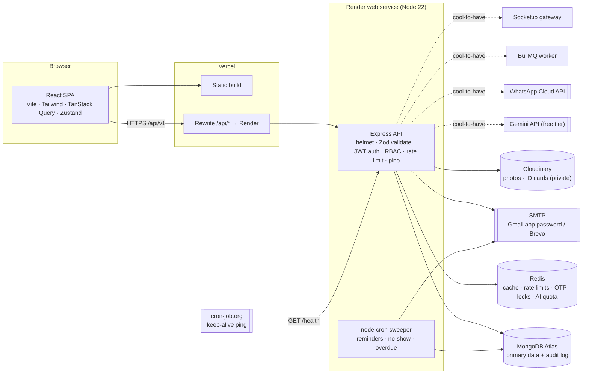
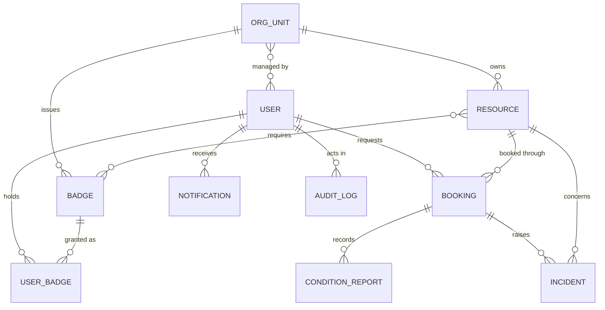
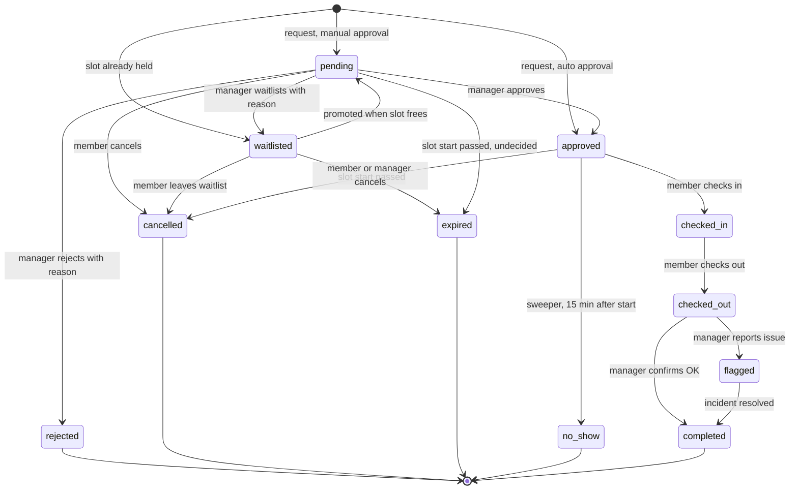
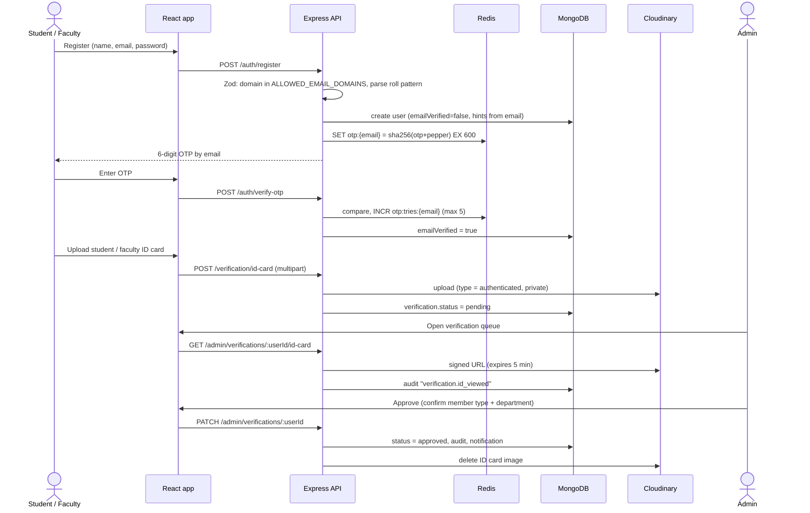

# CampusCommons: System Architecture

> **CampusCommons** (working name) lets departments and central facilities at **NIT Jamshedpur** share underused spaces, equipment and computing resources with verified students and faculty.
>
> Stack: **MongoDB · Express · React · Node.js · Tailwind CSS**, plus Redis.
>
> It is built for a 48-hour hackathon. It is an independent prototype and is not affiliated with the institute: no official logo or branding is used.

Related docs: [`backend.md`](./backend.md) · [`frontend.md`](./frontend.md)

---

## 1. Product summary

### 1.1 Use case

NIT Jamshedpur (Adityapur, Jamshedpur, Jharkhand 831014) has 12 academic departments, the Design and Innovation Centre, and several central facilities. Equipment and rooms owned by one unit often sit idle while students in another unit cannot get access. Typical examples are a 3D printer in the DIC, an oscilloscope in ECE, a GPU workstation in the Computer Centre, or a lathe in the Central Workshop. Buying or renting such items privately is too expensive for a student or a student startup.

CampusCommons is a **campus-internal** sharing platform:

- Only people with an `@nitjsr.ac.in` email can join.
- Every account is confirmed by a human who checks a **student or faculty ID card**.
- Every resource carries its own eligibility rules (training badges, member type, department), approval mode and fair-usage limits.
- Every booking moves through an auditable lifecycle, from request to return confirmation.

### 1.2 Institution data (taken from the public site nitjsr.ac.in)

These become the seeded **OrgUnits**, the owners of resources:

| Type               | OrgUnits (code)                                                                                                                                                                                                                                                                                       |
| ------------------ | ----------------------------------------------------------------------------------------------------------------------------------------------------------------------------------------------------------------------------------------------------------------------------------------------------- |
| Departments        | CSE (`cse`), ECE (`ece`), Electrical (`ee`), Mechanical (`mech`), Civil (`civil`), Metallurgical & Materials (`mme`), Production & Industrial (`prod`), Chemistry (`chem`), Physics (`phys`), Mathematics (`maths`), Computer Applications (`mca`), Humanities, Social Sciences & Management (`hssm`) |
| Centres            | Design and Innovation Centre (`dic`; est. 2024, M.Des Product Design), Centre for Innovation and Incubation (`ciic`)                                                                                                                                                                                  |
| Central facilities | Central Workshop (`cw`), Computer Centre (`cc`), Central Library (`lib`), Students' Activities Centre (`sac`)                                                                                                                                                                                         |

The department pages also name these labs in Production & Industrial: CAD/CAM, Advanced Manufacturing & FMS, Non-Traditional Manufacturing, and Industrial Engineering & Ergonomics.

> **Data ethics.** The site's code also contains real staff names and phone numbers. **We use none of them.** Only unit names are reused. All seeded people, roll numbers and inventory are fictional (hackathon rules 9 and 10).

### 1.3 Roles

| Role        | Who at NIT JSR                                    | Can do                                                                                                                                         |
| ----------- | ------------------------------------------------- | ---------------------------------------------------------------------------------------------------------------------------------------------- |
| **Member**  | Student (UG / PG / Research Scholar) or Faculty   | Browse, check eligibility, request badges, book, check in and out, report incidents, and see their own history                                 |
| **Manager** | Faculty in-charge or lab technician of an OrgUnit | List and edit their unit's resources, grant badges, approve, reject or waitlist requests, run handovers, confirm returns, and handle incidents |
| **Admin**   | Institute-level delegate                          | Verify ID cards, manage OrgUnits and roles, suspend users, resolve escalated incidents, and view the full audit log                            |

A user can hold several roles at once; for example, a faculty member can be both a Member and a Manager. The _owner_ of a resource is its **OrgUnit**. Managers act on the unit's behalf, so ownership does not depend on one person.

### 1.4 The 10-step lifecycle in the system

| #   | Lifecycle step (problem statement)               | Screen                                            | API                                                                        | Booking state                           |
| --- | ------------------------------------------------ | ------------------------------------------------- | -------------------------------------------------------------------------- | --------------------------------------- |
| 1   | Owner lists a resource and its conditions        | Manage → New resource                             | `POST /resources`                                                          | —                                       |
| 2   | User discovers it and checks eligibility         | Explore → Resource detail                         | `GET /resources`, `GET /resources/:id/eligibility`                         | —                                       |
| 3   | User submits a booking request                   | Resource detail → Book                            | `POST /bookings/check`, `POST /bookings`                                   | `pending` / `approved` / `waitlisted`   |
| 4   | System verifies requirements                     | (automatic)                                       | Eligibility engine inside `POST /bookings`                                 | Rule results saved on the booking       |
| 5   | Owner or manager reviews                         | Manage → Requests                                 | `GET /bookings/manage`                                                     | `pending`                               |
| 6   | Approved, rejected or waitlisted                 | Manage → Requests                                 | `POST /bookings/:id/approve \| reject \| waitlist`                         | `approved` / `rejected` / `waitlisted`  |
| 7   | User checks in and records the initial condition | Booking → Check in                                | `POST /bookings/:id/check-in`                                              | `checked_in`                            |
| 8   | Return and final condition recorded              | Booking → Check out, then Manage → Confirm return | `POST /bookings/:id/check-out`, `POST /bookings/:id/confirm-return`        | `checked_out` → `completed` / `flagged` |
| 9   | Delay, damage or conflict reported and handled   | Incident form / Manage → Incidents                | `POST /incidents`, `POST /incidents/:id/resolve`, plus the overdue sweeper | `flagged` → `completed`                 |
| 10  | Both parties see the full history                | Booking → Timeline; Admin → Audit                 | `GET /bookings/:id/timeline`, `GET /audit`                                 | —                                       |

### 1.5 Judging-criteria coverage

| Criterion (points)                        | What covers it                                                                                                                                          |
| ----------------------------------------- | ------------------------------------------------------------------------------------------------------------------------------------------------------- |
| Understanding of the problem (15)         | NIT JSR-specific OrgUnits, ID-card verification, per-resource risk levels and badges, and a privacy-aware design                                        |
| Strength of the core solution (20)        | One focused lifecycle; each rejection or waitlist decision states its reason and how to fix it                                                          |
| Working end-to-end product (20)           | Seeded demo accounts, a one-click role switcher, and a scripted golden path (see [`frontend.md` §11](./frontend.md#11-judge-golden-path-demo-script))   |
| Technical depth and reliability (15)      | Zod validation everywhere, Redis locks against double booking, an idempotent cron sweeper, caching, per-user rate limits, and structured logs           |
| Trust, safety and accountability (10)     | Human ID verification, badges, before and after condition reports with photos, incidents with human resolution, and an append-only audit log            |
| Fair allocation and accessibility (10)    | Weekly hour caps, an active-booking cap, a transparent FIFO waitlist, mandatory override reasons, and WCAG-AA UI                                        |
| Originality and real-world potential (10) | Campus-email plus ID verification, explainable eligibility, an AI assistant under a hard quota that sends no personal data, and NIT JSR-ready seed data |

---

## 2. High-level architecture



Solid lines are the MVP. Dashed lines are cool-to-have.

**Why each choice:**

- **The `/api` rewrite on Vercel.** The browser sees the API on the same origin as the SPA. That means:
  - the refresh-token cookie is first-party, so `SameSite=Strict` works and Safari's third-party cookie blocking doesn't matter;
  - no CORS preflights are needed in production.
- **One Node process for the API and the cron sweeper.** This is enough for a hackathon. A Redis lock stops the sweeper running twice if a second instance is ever added.
- **Redis is used across the MVP**: rate limits, OTPs, refresh-token allowlist, booking locks and caching. It is _not_ used for queues until BullMQ arrives (cool-to-have).

---

## 3. Repository layout

```
CodeConquerorHackathon/
├── client/                 # React + Vite + Tailwind (see frontend.md)
├── server/                 # Express API (see backend.md)
│   └── src/
│       ├── config/         # env parsing (Zod), db, redis, cloudinary, mailer
│       ├── models/         # Mongoose schemas
│       ├── validators/     # Zod schemas per route group
│       ├── middleware/     # requestId, logger, auth, rbac, validate, rateLimit, errorHandler
│       ├── routes/         # express.Router per group → controllers
│       ├── controllers/    # HTTP in/out only
│       ├── services/       # business logic (booking, audit, notify, cache, ...)
│       ├── engines/        # pure functions: eligibility, stateMachine
│       ├── jobs/           # node-cron sweeper
│       ├── lib/            # AppError, logger, log, serviceError, time (IST), emailPattern, lock, redisKeys, rate-limit store
│       └── seed/           # fictional NIT JSR demo data
└── docs/                   # these docs
```

Every request passes through the same pipeline:

```
request → requestId → pino-http → helmet/json limit → [auth] → [rateLimit] → validate(Zod) → [rbac/scope] → controller → service → model
                                                                                                           ↘ auditService / notifyService / cache invalidation
errors anywhere → errorHandler → { success:false, error, requestId }
```

On auth routes, `[rateLimit]` runs after `validate(Zod)`, because those limiters key on the validated email (§11).

Services throw errors that carry `status`, `code` and, where useful, `details` and `headers` (`Retry-After`). The error handler sends them as they are. These errors include `AppError`, `ServiceError`, the booking lock's 503 and the AI quota's 429 and 503.

---

## 4. Domain model



| Collection         | Purpose                                                                              |
| ------------------ | ------------------------------------------------------------------------------------ |
| `users`            | Identity, roles, member type, department, verification status, strikes               |
| `orgunits`         | Departments, centres and facilities, with their managers                             |
| `resources`        | A listing plus availability, eligibility rules, limits and condition checklist       |
| `badges`           | Training or qualification catalogue (e.g. "3D Printing Basics" issued by DIC)        |
| `userbadges`       | A user's badge requests and grants (`requested → active / rejected / revoked`)       |
| `bookings`         | Requests and their lifecycle; waitlist entries are bookings with status `waitlisted` |
| `conditionreports` | Check-in, check-out and return-confirmation checklists with photos                   |
| `incidents`        | Damage, delay, misuse, safety or conflict reports, with their human resolution       |
| `notifications`    | In-app notification feed                                                             |
| `auditlogs`        | Append-only record of every important action                                         |

Field-level schemas and indexes are in [`backend.md` §5](./backend.md#5-data-models).

---

## 5. Booking state machine



`overdue` is **not a state**. It is a flag (`flags.overdue`) that the sweeper sets on a `checked_in` booking once `end + 15 min` has passed. A flagged booking still follows the normal `checked_out` path.

| From → To                                           | Who                          | Requires                                               | Side effects                                                                                                     |
| --------------------------------------------------- | ---------------------------- | ------------------------------------------------------ | ---------------------------------------------------------------------------------------------------------------- |
| — → `pending` / `approved` / `waitlisted`           | Member                       | All hard eligibility rules pass                        | Eligibility snapshot saved; audit `booking.requested`; notify managers (pending) or member (approved/waitlisted) |
| `pending` → `approved`                              | Manager of the OrgUnit       | Conflict re-check passes                               | Audit `booking.approved`; notify member                                                                          |
| `pending` → `rejected`                              | Manager                      | `reason` (10–500 chars)                                | Audit; notify member; promote waitlist                                                                           |
| `pending` → `waitlisted`                            | Manager                      | `reason`                                               | Audit; notify member with their position; promote the next waitlisted request (never this one)                   |
| `pending` / `approved` / `waitlisted` → `cancelled` | Member (own) or Manager      | `reason` (required for managers, optional for members) | Audit; notify the other party; promote waitlist                                                                  |
| `waitlisted` → `pending`                            | System                       | Freed slot plus an eligibility re-check                | Audit `booking.promoted` (actor `system`); notify member                                                         |
| `waitlisted` / `pending` → `expired`                | System (sweeper)             | `start < now` (pending: no manager decided in time)    | Audit; notify member; promote waitlist if it was pending                                                         |
| `approved` → `checked_in`                           | Member (or Manager for them) | Within 15 min before start to end; condition report    | Audit; notify managers                                                                                           |
| `approved` → `no_show`                              | System (sweeper)             | `start + 15 min < now`, no check-in                    | Audit; notify both parties; promote waitlist                                                                     |
| `checked_in` → `checked_out`                        | Member                       | Condition report                                       | Audit; notify managers ("confirm return")                                                                        |
| `checked_out` → `completed`                         | Manager                      | `outcome: ok`                                          | Audit; notify member                                                                                             |
| `checked_out` → `flagged`                           | Manager                      | `outcome: issue` plus incident details                 | Incident created; audit; notify member and admins                                                                |
| `flagged` → `completed`                             | Manager / Admin              | Incident resolved                                      | Audit; notify member                                                                                             |

**No self-review.** A manager can't approve, reject, waitlist or confirm the return of their own booking. Another manager of the unit, or an admin, must do it.

All transitions run through **one function**, `bookingService.transition(bookingId, action, actor, payload)`, driven by the `TRANSITIONS` map in `engines/stateMachine.js` (see [`backend.md` §6.2](./backend.md#62-booking-state-machine)), so no controller can bypass the rules or forget the audit entry.

---

## 6. API routes

Base path: **`/api/v1`**. JSON in and out, except for multipart uploads.

**Response envelope:**

```json
{
  "success": true,
  "data": {},
  "meta": { "page": 1, "limit": 20, "total": 57 },
  "requestId": "a1b2c3"
}
```

```json
{
  "success": false,
  "error": {
    "code": "INELIGIBLE",
    "message": "You don't meet 1 requirement for this resource.",
    "details": [
      {
        "rule": "BADGES",
        "passed": false,
        "message": "Missing badge: 3D Printing Basics",
        "fixHint": "Request it from Design and Innovation Centre"
      }
    ]
  },
  "requestId": "a1b2c3"
}
```

**Error codes:**

| Code                  | HTTP status |
| --------------------- | ----------- |
| `VALIDATION_ERROR`    | 400         |
| `UNAUTHENTICATED`     | 401         |
| `EMAIL_NOT_VERIFIED`  | 403         |
| `FORBIDDEN`           | 403         |
| `NOT_FOUND`           | 404         |
| `SLOT_TAKEN`          | 409         |
| `INVALID_TRANSITION`  | 409         |
| `INELIGIBLE`          | 422         |
| `RATE_LIMITED`        | 429         |
| `AI_QUOTA_EXCEEDED`   | 429         |
| `AI_UNAVAILABLE`      | 503         |
| `SERVICE_UNAVAILABLE` | 503         |
| `INTERNAL`            | 500         |

**How to read the tables below:**

- **Auth:** `public`, `auth` (any logged-in user), `verified` (ID card approved), `member`, `manager*` (a manager of the resource's OrgUnit), `admin`.
- **Rate tier:** see §11.
- **Cache:** see §10.

### 6.1 MVP routes

**Auth**

| Method | Path               | Auth                                 | Body / query (Zod)                                                             | Rate tier                      | Cache |
| ------ | ------------------ | ------------------------------------ | ------------------------------------------------------------------------------ | ------------------------------ | ----- |
| POST   | `/auth/register`   | public                               | `name, email, password`                                                        | `register` (email)             | —     |
| POST   | `/auth/verify-otp` | public                               | `email, otp`. On success, signs the user in (access token plus refresh cookie) | `otpVerify` (email)            | —     |
| POST   | `/auth/resend-otp` | public                               | `email`                                                                        | `otpSend` (email)              | —     |
| POST   | `/auth/login`      | public                               | `email, password`                                                              | `login` (email, failures only) | —     |
| POST   | `/auth/refresh`    | refresh cookie                       | —                                                                              | `general` (userId from cookie) | —     |
| POST   | `/auth/logout`     | auth                                 | —                                                                              | `general`                      | —     |
| GET    | `/auth/me`         | auth                                 | —                                                                              | `general`                      | —     |
| POST   | `/auth/demo-login` | public, **only if `DEMO_MODE=true`** | `role: member \| member2 \| faculty \| manager \| admin`                       | `demo` (role)                  | —     |

If a user whose email is not yet verified tries to log in, they get `403 EMAIL_NOT_VERIFIED`, a fresh OTP is sent, and the client redirects them to `/verify-otp`.

**Verification**

| Method | Path                                   | Auth                  | Body / query                                                             | Rate tier | Cache |
| ------ | -------------------------------------- | --------------------- | ------------------------------------------------------------------------ | --------- | ----- |
| POST   | `/verification/id-card`                | auth (email verified) | multipart `idCard` (jpg/png/webp/pdf ≤ 5 MB), `memberType`, `department` | `upload`  | —     |
| GET    | `/verification/status`                 | auth                  | —                                                                        | `general` | —     |
| GET    | `/admin/verifications`                 | admin                 | `status=pending\|approved\|rejected, page, limit`                        | `general` | —     |
| GET    | `/admin/verifications/:userId/id-card` | admin                 | — (returns a 5-min signed URL; **audited**)                              | `general` | —     |
| PATCH  | `/admin/verifications/:userId`         | admin                 | `decision: approve\|reject, reason, memberType, department`              | `general` | —     |

**OrgUnits**

| Method | Path                      | Auth  | Body / query                 | Rate tier | Cache                   |
| ------ | ------------------------- | ----- | ---------------------------- | --------- | ----------------------- |
| GET    | `/org-units`              | auth  | —                            | `general` | `cache:orgunits` 10 min |
| POST   | `/org-units`              | admin | `name, code, type, location` | `general` | invalidate              |
| PATCH  | `/org-units/:id`          | admin | partial                      | `general` | invalidate              |
| PUT    | `/org-units/:id/managers` | admin | `managerIds[]`               | `general` | invalidate              |

**Resources**

| Method | Path                          | Auth                   | Body / query                                                                                                                                                                                                          | Rate tier | Cache                              |
| ------ | ----------------------------- | ---------------------- | --------------------------------------------------------------------------------------------------------------------------------------------------------------------------------------------------------------------- | --------- | ---------------------------------- |
| GET    | `/resources`                  | auth                   | `q, category, orgUnit, memberType, date` (IST `YYYY-MM-DD`), `status` (comma list, e.g. `active,maintenance`; non-active only for managers of the unit or admins, default `active`), `page, limit(≤50), eligibleOnly` | `general` | `cache:resources:v{n}:{hash}` 60 s |
| GET    | `/resources/:id`              | auth                   | —                                                                                                                                                                                                                     | `general` | `cache:resource:{id}` 5 min        |
| POST   | `/resources`                  | manager (of `orgUnit`) | see `backend.md` §7                                                                                                                                                                                                   | `general` | bump list version                  |
| PATCH  | `/resources/:id`              | manager\*              | partial                                                                                                                                                                                                               | `general` | delete key, bump version           |
| PATCH  | `/resources/:id/status`       | manager\*              | `status: active\|maintenance\|archived, reason`                                                                                                                                                                       | `general` | delete key, bump version           |
| GET    | `/resources/:id/availability` | auth                   | `from, to` (≤ 14 days) → `{ quantity, openWindows[{start, end}], busy[{start, end, inUse, full}] }`. Blackouts are already cut out of `openWindows`; **no borrower data**                                             | `general` | —                                  |
| GET    | `/resources/:id/eligibility`  | auth                   | `start?, end?` → rule checklist for the current user                                                                                                                                                                  | `general` | —                                  |
| GET    | `/resources/:id/bookings`     | manager\*              | `status, from, to, page`                                                                                                                                                                                              | `general` | —                                  |

With `eligibleOnly`, the base list is cached and then filtered for the current user in memory, so the cache holds no per-user data.

**Badges**

| Method | Path                   | Auth                          | Body / query                                                        | Rate tier | Cache                 |
| ------ | ---------------------- | ----------------------------- | ------------------------------------------------------------------- | --------- | --------------------- |
| GET    | `/badges`              | auth                          | `orgUnit?`                                                          | `general` | `cache:badges` 10 min |
| POST   | `/badges`              | manager / admin               | `name, code, orgUnit, description, validityDays?, evidenceRequired` | `general` | invalidate            |
| GET    | `/badges/mine`         | auth                          | —                                                                   | `general` | —                     |
| POST   | `/badges/:id/requests` | verified                      | `note`, optional multipart `evidence`                               | `upload`  | —                     |
| GET    | `/badge-requests`      | manager (badges of own units) | `status=requested, page`                                            | `general` | —                     |
| PATCH  | `/badge-requests/:id`  | manager\*                     | `decision: approve\|reject, reason`                                 | `general` | —                     |
| POST   | `/badges/:id/grant`    | manager\*                     | `userId, note`                                                      | `general` | —                     |

**Bookings**

| Method | Path                           | Auth                         | Body / query                                                                                                                        | Rate tier       | Cache |
| ------ | ------------------------------ | ---------------------------- | ----------------------------------------------------------------------------------------------------------------------------------- | --------------- | ----- |
| POST   | `/bookings/check`              | verified                     | `resourceId, start, end` → dry run: rule checklist plus availability or waitlist position                                           | `general`       | —     |
| POST   | `/bookings`                    | verified                     | `resourceId, start, end, purpose, joinWaitlist?`                                                                                    | `bookingCreate` | —     |
| GET    | `/bookings/mine`               | auth                         | `status, page`                                                                                                                      | `general`       | —     |
| GET    | `/bookings/manage`             | manager                      | `status, resourceId?, from?, to?, page, limit` (own units only); with `status=pending`, results are **grouped by conflicting slot** | `general`       | —     |
| GET    | `/bookings/:id`                | borrower / manager\* / admin | —                                                                                                                                   | `general`       | —     |
| POST   | `/bookings/:id/approve`        | manager\*                    | `note?`                                                                                                                             | `general`       | —     |
| POST   | `/bookings/:id/reject`         | manager\*                    | `reason` (required)                                                                                                                 | `general`       | —     |
| POST   | `/bookings/:id/waitlist`       | manager\*                    | `reason` (required)                                                                                                                 | `general`       | —     |
| POST   | `/bookings/:id/cancel`         | borrower / manager\*         | `reason` (required for managers)                                                                                                    | `general`       | —     |
| POST   | `/bookings/:id/check-in`       | borrower / manager\*         | `items[{label, ok, note}], photos[], overall, notes`                                                                                | `general`       | —     |
| POST   | `/bookings/:id/check-out`      | borrower / manager\*         | same shape                                                                                                                          | `general`       | —     |
| POST   | `/bookings/:id/confirm-return` | manager\*                    | `outcome: ok\|issue, items[], photos[], note, incident?{type, severity, description}`                                               | `general`       | —     |
| GET    | `/bookings/:id/timeline`       | borrower / manager\* / admin | — (audit entries plus condition reports, merged)                                                                                    | `general`       | —     |

**Incidents**

| Method | Path                      | Auth                                          | Body / query                                                      | Rate tier | Cache |
| ------ | ------------------------- | --------------------------------------------- | ----------------------------------------------------------------- | --------- | ----- |
| POST   | `/incidents`              | borrower of booking / manager\*               | `bookingId?, resourceId, type, severity, description, photos[]`   | `general` | —     |
| GET    | `/incidents`              | member (own) / manager (unit) / admin         | `status, type, severity, resourceId, page`                        | `general` | —     |
| GET    | `/incidents/:id`          | parties / manager\* / admin                   | —                                                                 | `general` | —     |
| POST   | `/incidents/:id/comments` | parties / manager\* / admin                   | `text`                                                            | `general` | —     |
| POST   | `/incidents/:id/resolve`  | manager\* (low/medium severity) / admin (any) | `outcome: no_action\|warning\|repair_required\|strike, rationale` | `general` | —     |

**Notifications**

| Method | Path                          | Auth | Body / query          | Rate tier | Cache |
| ------ | ----------------------------- | ---- | --------------------- | --------- | ----- |
| GET    | `/notifications`              | auth | `unread?, page`       | `general` | —     |
| GET    | `/notifications/unread-count` | auth | — (polled every 30 s) | `general` | —     |
| PATCH  | `/notifications/:id/read`     | auth | —                     | `general` | —     |
| PATCH  | `/notifications/read-all`     | auth | —                     | `general` | —     |

**Audit, uploads, admin, health**

| Method | Path                       | Auth                              | Body / query                                                                                                        | Rate tier | Cache     |
| ------ | -------------------------- | --------------------------------- | ------------------------------------------------------------------------------------------------------------------- | --------- | --------- |
| GET    | `/audit`                   | admin (all) / manager (own units) | `entityType, entityId, actorId, action, from, to, page`                                                             | `general` | —         |
| POST   | `/uploads/images`          | verified                          | multipart `images` (≤ 3, jpg/png/webp, ≤ 5 MB each) → `[{url, publicId}]`                                           | `upload`  | —         |
| GET    | `/admin/users`             | admin                             | `q, role, verification, page`                                                                                       | `general` | —         |
| PATCH  | `/admin/users/:id/roles`   | admin                             | `roles[], managedOrgUnits[]`                                                                                        | `general` | —         |
| PATCH  | `/admin/users/:id/suspend` | admin                             | `until \| null, reason`                                                                                             | `general` | —         |
| GET    | `/health`                  | public                            | — → `{ status, mongo, redis, uptime }`                                                                              | none      | —         |
| GET    | `/meta`                    | public                            | — → `{ demoMode, allowedEmailDomains, version }`; the login page uses it to decide whether to show the demo buttons | none      | in-memory |

### 6.2 Cool-to-have routes (not in MVP)

| Method | Path                                               | Auth                 | Purpose                                                                                                   |
| ------ | -------------------------------------------------- | -------------------- | --------------------------------------------------------------------------------------------------------- |
| POST   | `/ai/search`                                       | verified             | Natural-language search. Gemini turns the query into filters, then a ranked list with reasons (tier `ai`) |
| GET    | `/ai/quota`                                        | auth                 | `{ used, limit, remaining, resetsAt }` for the "AI searches left today" meter                             |
| POST   | `/ai/incidents/:id/summary`                        | manager\* / admin    | Neutral summary of an incident (PII scrubbed)                                                             |
| POST   | `/ai/bookings/:id/condition-compare`               | manager\*            | Before/after photo comparison as a _suggestion_                                                           |
| POST   | `/bookings/:id/extensions`                         | borrower             | Request a new end time                                                                                    |
| PATCH  | `/bookings/:id/extensions/:extId`                  | manager\*            | Approve or deny an extension (conflict re-check)                                                          |
| POST   | `/bookings/:id/offer/accept` · `/offer/decline`    | borrower             | Timed waitlist offers                                                                                     |
| GET    | `/resources/:id/alternatives`                      | auth                 | Next free slots and similar resources when a slot is taken                                                |
| GET    | `/bookings/:id/qr` · POST `/bookings/scan`         | borrower / manager\* | Signed QR pass for check-in and check-out                                                                 |
| POST   | `/incidents/:id/appeal`                            | borrower             | Contest an incident outcome; goes to an admin                                                             |
| GET    | `/audit/verify`                                    | admin                | Recompute the hash chain and report the first broken link                                                 |
| GET    | `/analytics/overview` · `/analytics/resources/:id` | manager / admin      | Utilisation, underused list, demand heatmap, Gini coefficient                                             |
| POST   | `/trainings/:badgeId/attempt`                      | verified             | Micro-quiz that auto-grants low-risk badges                                                               |
| GET    | `/calendar/:token.ics`                             | token                | Personal booking feed for Google Calendar                                                                 |
| PATCH  | `/users/me/whatsapp`                               | auth                 | WhatsApp opt-in or opt-out plus phone number (E.164)                                                      |

---

## 7. Authentication and authorization

### 7.1 Tokens

- **Access token:** a JWT (HS256) valid for **15 min**, holding `sub, roles, memberType, managedOrgUnits, verified`. It is kept **in memory** on the client (Zustand), never in localStorage.
- **Refresh token:** a JWT valid for **7 days** with a `jti`.
  - It is set as an `httpOnly; Secure; SameSite=Strict; Path=/api/v1/auth` cookie.
  - Its `jti` is allow-listed in Redis (`auth:refresh:{userId}:{jti}`, TTL 7 days).
  - It **rotates** on every refresh: the old `jti` is deleted and a new one issued.
  - If an already-used `jti` shows up again, every refresh token for that user is revoked (reuse detection).
- **Passwords:** bcrypt with cost 12. Policy: 8–72 characters, at least one letter and one digit (72 is bcrypt's input limit).
- **Suspension:** a suspended user can still log in, but every mutating route returns 403 `FORBIDDEN` with the suspension reason and end date.

### 7.2 RBAC matrix

| Action                               |         Member          |         Manager          | Admin  |
| ------------------------------------ | :---------------------: | :----------------------: | :----: |
| Browse resources                     |           ✅            |            ✅            |   ✅   |
| Book (requires `verified`)           |           ✅            |     ✅ (as a member)     |   ✅   |
| Create or edit resources             |            —            |       ✅ own units       |   ✅   |
| Approve, reject or waitlist bookings |            —            |       ✅ own units       |   ✅   |
| Grant badges                         |            —            |   ✅ own units' badges   |   ✅   |
| Confirm returns                      |            —            |       ✅ own units       |   ✅   |
| Resolve incidents                    |            —            | ✅ low/medium, own units | ✅ all |
| Verify ID cards                      |            —            |            —             |   ✅   |
| Manage roles, OrgUnits, suspensions  |            —            |            —             |   ✅   |
| View audit log                       | own bookings' timelines |        own units         | ✅ all |

### 7.3 Scope checks (ABAC)

Roles alone are not enough. Every route that takes `:id` loads the document, then checks:

- `isBorrower = booking.borrower == user.id`
- `isUnitManager = user.managedOrgUnits.includes(doc.orgUnit)`
- `isAdmin`

A manager of CSE cannot approve a DIC booking even though both are "managers". `orgUnit` is **denormalised onto bookings and incidents** so the check needs no extra query.

---

## 8. Verification flow



**Email-pattern hints.** NIT JSR student addresses follow `YYYY{ug|pg|rs}{branch}{NNN}@nitjsr.ac.in`. Examples of the format: `2024ugcs999`, `2023pgcese01`, `2022rsec012`.

```
^(?<year>\d{4})(?<level>ug|pg|rs)(?<branch>[a-z]{2,6})(?<serial>\d{2,4})@nitjsr\.ac\.in$
```

- **A match** pre-fills the member type (UG, PG or Research Scholar), the admission year, and a department mapped from `branch` through a lookup table (`cs → cse`, `ec → ece`, `ee → ee`, `me → mech`, `ce → civil`, `mm → mme`, `pi → prod`, …). Unknown branch codes leave the department blank for the user to choose.
- **Any other `@nitjsr.ac.in` address** (e.g. `firstname.dept@`) is treated as a faculty/staff candidate, who uploads a **faculty ID card**.
- **The pattern only gives hints.** An admin always confirms the member type and department against the ID card. Before relying on the regex, check it against the team members' own emails.

**Privacy:**

- ID images are stored with Cloudinary's `authenticated` delivery type and are not publicly reachable.
- Only admins can view them, through 5-minute signed URLs, and each view writes an audit entry.
- The image is **deleted once a decision is made**. The decision record (who, when, outcome, reason) is kept.

**Judges** don't have `@nitjsr.ac.in` emails. They use the seeded demo accounts through `POST /auth/demo-login`. Seeded users live on `@demo.campuscommons.test`, a domain the mailer never sends to.

---

## 9. Concurrency: preventing double booking

The danger is two students requesting the last free slot of the 3D printer in the same 50 ms.

```
POST /bookings
  1. validate + eligibility (no lock yet, read-only)
  2. lock = SET lock:resource:{id} <uuid> NX PX 5000      ← Redis
     └─ not acquired → retry 3× with 100 ms jitter → else 503 SERVICE_UNAVAILABLE ("try again")
  3. holders = Booking.find({
        resource: id,
        status: { $in: ['pending', 'approved', 'checked_in'] },
        start: { $lt: end }, end: { $gt: start } }, { start, end })
     inUse = most holders overlapping at any one moment of [start, end)
  4. inUse < resource.quantity  → insert as pending / approved
     else                       → insert as waitlisted (if joinWaitlist) or 409 SLOT_TAKEN
  5. release lock with a Lua compare-and-delete (only if the value is still our uuid)
```

- **`pending` holds the slot.** The first requester gets it and later ones go to the waitlist (FIFO, transparent).
- **`quantity`** handles countable items (e.g. 5 IoT kits): a slot is free while fewer than `quantity` units are in use at its busiest moment. Counting every overlapping booking instead would let two short bookings (10–11 and 11–12) fill a 2-unit kit for a 10–12 request.
- **Approve re-checks** the overlap inside the same lock, as a defence in depth against manual edits and races.
- **If Redis is down, booking creation fails closed** with a 503 rather than risk a double booking. _Fallback documented for later:_ a Mongo transaction that also does `$inc: { bookingSeq: 1 }` on the resource document. Two concurrent transactions then write-conflict, and one retries.

---

## 10. Redis: usage and caching strategy

### 10.1 Key catalogue

| Key                                  | Type                                   | TTL    | Purpose                                    |
| ------------------------------------ | -------------------------------------- | ------ | ------------------------------------------ |
| `otp:{email}`                        | string (sha256 hash)                   | 10 min | Email OTP                                  |
| `otp:tries:{email}`                  | counter                                | 10 min | Max 5 attempts, then the OTP is deleted    |
| `auth:refresh:{userId}:{jti}`        | string                                 | 7 days | Refresh-token allowlist and rotation       |
| `rl:{tier}:{key}`                    | counter (`lib/redisRateLimitStore.js`) | window | Rate limiting (§11)                        |
| `lock:resource:{id}`                 | string (uuid)                          | 5 s    | Booking create and approve lock (§9)       |
| `lock:cron:sweep`                    | string                                 | 4 min  | Ensures only one instance runs the sweeper |
| `cache:resources:ver`                | counter                                | none   | Namespace version for list invalidation    |
| `cache:resources:v{n}:{sha1(query)}` | JSON                                   | 60 s   | Resource list / search results             |
| `cache:resource:{id}`                | JSON                                   | 5 min  | Resource detail                            |
| `cache:orgunits`, `cache:badges`     | JSON                                   | 10 min | Rarely changing catalogues                 |
| `ai:{q}:burst:{userId}`              | flag                                   | 10 s   | AI per-user burst limit (cool-to-have)     |
| `ai:{q}:user:{userId}:{YYYYMMDD}`    | counter                                | 48 h   | AI per-user daily quota                    |
| `ai:{q}:global:{YYYYMMDD}`           | counter                                | 48 h   | AI global daily cap                        |
| `ai:{q}:rpm:{YYYYMMDDHHmm}`          | counter                                | 120 s  | AI global per-minute cap                   |
| `ai:cache:{feature}:{sha256(input)}` | JSON                                   | 24 h   | Cached AI responses (a hit costs no quota) |
| `ai:circuit`                         | flag                                   | 10 min | Opened when Gemini returns 429             |

`{q}` is a literal **hash tag**. It keeps every AI-quota key in one cluster slot, so the multi-key Lua script also works on clustered providers. Dates are **IST** (`Asia/Kolkata`).

### 10.2 Caching pattern

- **Cache-aside.** Read from Redis; on a miss, read Mongo, write Redis with a TTL, and return.
- **List invalidation by versioning.** Any resource write runs `INCR cache:resources:ver`. All old list keys become unreachable and expire on their own. There is no `KEYS` or `SCAN` scan.
- **Detail invalidation.** `DEL cache:resource:{id}` on update or status change.
- **Never cached:** per-user data (eligibility, bookings, notifications, quotas) and availability, which changes with every booking. Those come from indexed Mongo queries.
- **When Redis is down,** each use has a defined behaviour:

| Use          | Behaviour                                            | Why                          |
| ------------ | ---------------------------------------------------- | ---------------------------- |
| Cache        | Fail **open**: read Mongo, log `warn`                | The app must keep working    |
| Rate limiter | Fail **open** (`passOnStoreError: true`): log `warn` | Availability over protection |
| Booking lock | Fail **closed** (503)                                | Correctness                  |
| AI quota     | Fail **closed**: no AI; normal search still works    | The quota is hard            |

---

## 11. Rate limiting (no IP-based keys)

**Why there are no IP keys.** Hostels and departments share campus Wi-Fi, so hundreds of students reach the internet through a handful of public IPs. A per-IP limit would let one heavy user lock out a whole hostel. So:

1. **Every non-auth route requires login**, so every request has a `userId` to key on.
2. **Auth routes key on the normalised email** (lower-cased and trimmed). Requests are validated by Zod _before_ the limiter runs, so the key always exists.
3. `app.set('trust proxy', 1)` stays on, but only so logs record the real client address. **It is never used as a limiter key.**

Implementation: `express-rate-limit` with a small Redis store (`lib/redisRateLimitStore.js`), a custom `keyGenerator` per tier, and `standardHeaders: 'draft-7'`. Every 429 response carries `Retry-After` and a human-readable message: _"Too many failed login attempts for this account. Try again in 12 minutes."_

- **Why not `rate-limit-redis`:** routers create their limiters when they're imported, before Redis is connected. `rate-limit-redis` loads its scripts at that moment. Up to v6.0.1 it never retries, so every limiter would stay off. The fix is in v6.0.2, which was a day old when this was built. The custom store uses ioredis `defineCommand`, which loads its script on first use. It keeps the same `rl:{tier}:{key}` keys, so switching later is a drop-in change.
- **Mounting:** the auth tiers go after `validate(Zod)`. The user tiers go after the auth middleware. A key generator with no email or `req.user` throws a 500 on purpose, rather than putting everyone on one shared counter.

| Tier            | Key                | Limit                          | Notes                                                                                                                                                         |
| --------------- | ------------------ | ------------------------------ | ------------------------------------------------------------------------------------------------------------------------------------------------------------- |
| `login`         | email              | 5 **failed** attempts / 15 min | `skipSuccessfulRequests: true`. Known risk: someone could deliberately lock out a victim's account; mitigated by the short window (OTP login is cool-to-have) |
| `register`      | email              | 3 / hour                       |                                                                                                                                                               |
| `otpSend`       | email              | 3 / 15 min **and** 10 / day    | Two limiters stacked                                                                                                                                          |
| `otpVerify`     | email              | 10 / 15 min                    | Plus the per-OTP attempt cap (5)                                                                                                                              |
| `demo`          | role               | 60 / 15 min                    | Judges share demo accounts, so the limit is generous                                                                                                          |
| `general`       | userId             | 300 / 5 min                    | Applied to the whole authenticated router                                                                                                                     |
| `bookingCreate` | userId             | 10 / hour                      | Discourages slot-spamming                                                                                                                                     |
| `upload`        | userId             | 20 / hour                      | ID cards, condition photos, evidence                                                                                                                          |
| `ai`            | userId plus global | **Hard quota** (§15.2)         | Custom middleware, not `express-rate-limit`                                                                                                                   |

---

## 12. Input validation

Defence in depth:

- **Zod at the edge (authoritative).** `validate({ body, params, query })` middleware runs on **every** route. Unknown keys are stripped (`.strip()`), and types are coerced only where safe (query strings → numbers and dates). The parsed result replaces `req.body`, `req.params` and `req.query`, so controllers only ever see clean data.
- **Mongoose schema validators (second layer).** These are `required`, `enum`, `min/max`, `maxlength` and custom validators, which catch bugs in internal writes such as cron jobs and seeds.
- **Query safety.** `mongoose.set('strictQuery', 'throw')` (in `config/db.js`). A filter field that isn't in the schema throws an error. With `strictQuery: true` it would be dropped silently, so a typo in `deleteMany` would match every document. Operator injection (`{ "$gt": "" }`) is blocked by Zod, which turns ids, enums and text into plain values before any query runs. `sanitizeFilter` is **not** used: it rewrites every `$` operator, including the services' own `$in` and `$lt`, so those queries fail with a `CastError`.
- **React Hook Form + Zod on the client** for instant feedback. **The server stays authoritative.**

**Validation catalogue** (full per-route schemas are in [`backend.md` §7](./backend.md#7-validation-catalogue)):

| Field type                               | Rule                                                                                                                                                                     |
| ---------------------------------------- | ------------------------------------------------------------------------------------------------------------------------------------------------------------------------ |
| Email                                    | Valid format, lower-cased, domain in `ALLOWED_EMAIL_DOMAINS` (default `nitjsr.ac.in`)                                                                                    |
| Password                                 | 8–72 characters, at least one letter and one digit                                                                                                                       |
| OTP                                      | Exactly 6 digits                                                                                                                                                         |
| ObjectId params                          | `/^[a-f\d]{24}$/i`                                                                                                                                                       |
| Free text (purpose, reason, description) | Trimmed, HTML tags stripped, length limits (purpose 10–300, reason 10–500, description 20–2000)                                                                          |
| Enums                                    | Status, category, member type, incident type and severity, decision                                                                                                      |
| Date ranges                              | ISO 8601; `start < end`; `start ≥ now + leadTime`; `start ≤ now + maxAdvanceDays`; duration within `[minDuration, maxDuration]`; aligned to the resource's `slotMinutes` |
| Pagination                               | `page ≥ 1`, `1 ≤ limit ≤ 50`                                                                                                                                             |
| Files                                    | MIME **and** magic-byte check (`file-type`); jpg/png/webp (plus pdf for ID cards and evidence); ≤ 5 MB; ≤ 3 per request; enforced by `multer` limits                     |
| Body size                                | `express.json({ limit: '100kb' })`                                                                                                                                       |
| Phone (WhatsApp, cool-to-have)           | E.164 format: `+91XXXXXXXXXX`                                                                                                                                            |

Validation failures return **400 `VALIDATION_ERROR`** with `details: [{ path: "end", message: "End must be after start" }]`. The frontend maps each `path` back onto the matching form field.

---

## 13. Logging and observability

### 13.1 Application logs (pino)

- **`pino` + `pino-http`.** Logs are JSON in production and pretty-printed with `pino-pretty` in development. The level comes from `LOG_LEVEL`.
- **Request IDs.** The id is taken from an incoming `X-Request-Id` or generated with `crypto.randomUUID()`. It is echoed back in the response header and the JSON envelope, so a user's bug report ("requestId a1b2c3") maps straight to a log line.
- **Standard fields** on every request log: `reqId, userId, roles, method, route, status, responseTimeMs`. **Request bodies are not logged.**
- **Redaction:** `req.headers.authorization`, `req.headers.cookie`, `res.headers["set-cookie"]`, `*.password`, `*.otp`, `*.token`, `*.idCard*`, `*.phone`.
- **Levels:**

| Level   | What                                                           |
| ------- | -------------------------------------------------------------- |
| `error` | 5xx responses and unhandled errors, with stack traces          |
| `warn`  | 4xx security events (403, 429), Redis fallbacks, Gemini errors |
| `info`  | Lifecycle events: booking state changes, sweeper results       |
| `debug` | Development only                                               |

- **Process safety:** handlers for `unhandledRejection` and `uncaughtException` log at `fatal` and exit. Render restarts the service.
- **Shipping (optional):** pipe to Better Stack or Grafana Loki through a pino transport. On free tiers, Render's log viewer is enough.

### 13.2 Domain audit log (MongoDB `auditlogs`)

This is separate from application logs. App logs are for **engineers** and get rotated. The audit log is for **accountability**: users, owners and admins read it, and it is kept.

```json
{
  "at": "2026-10-30T10:15:00+05:30",
  "actor": { "id": "…", "role": "manager" },
  "action": "booking.rejected",
  "entity": { "type": "booking", "id": "…" },
  "orgUnit": "…",
  "reason": "Printer reserved for M.Des jury",
  "changes": { "status": ["pending", "rejected"] },
  "requestId": "a1b2c3"
}
```

- **Append-only.** No update or delete routes exist, and Mongoose `pre('updateOne' | 'deleteOne' | …)` hooks throw on the model.
- **Action names follow `entity.verb`:**
  - `user.registered`, `verification.approved`, `verification.id_viewed`
  - `resource.created`, `resource.status_changed`
  - `badge.granted`
  - `booking.requested`, `booking.approved`, `booking.rejected`, `booking.waitlisted`, `booking.promoted`, `booking.cancelled`, `booking.checked_in`, `booking.checked_out`, `booking.completed`, `booking.flagged`, `booking.no_show`, `booking.overdue`
  - `incident.created`, `incident.resolved`
  - `user.suspended`
- **Cool-to-have:** each entry stores `prevHash` and `hash = sha256(prevHash + canonicalJSON(entry))`, and `GET /audit/verify` proves nothing was altered.

### 13.3 Health

`GET /health` returns `200 { status: "ok", mongo: "up", redis: "up", uptime }`. It returns `503` if Mongo is down. If only Redis is down it still returns 200 with `redis: "degraded"`, because the app can run without Redis (§10.2). The keep-alive pinger calls it.

---

## 14. Scheduled jobs (MVP: `node-cron`)

A single in-process job, **`sweep`**, runs every **5 minutes** (`*/5 * * * *`):

- It first acquires `lock:cron:sweep` in Redis. If the lock isn't free, it skips this run, so another instance doesn't repeat the work.
- **Each booking is claimed before anything is sent.** A conditional update sets the flag, or changes the status, on the state it expects. Only one sweep can win that update, so nothing is sent or changed twice, even when two sweeps run at once.
- **If Redis is down,** the sweep runs without the lock. The claims make that safe, and no-shows and late returns don't pile up.
- Status changes go through `bookingService.transition()` with the system as the actor. They get the same guards, audit entries and notifications as a person's action, and a no-show still promotes the waitlist.
- `startSweeper()` also sweeps once at boot, to catch up on runs missed while a free instance slept. `CRON_ENABLED=false` turns it off.

The steps run in this order, so slots freed by no-shows go to the waitlist before expiry runs:

| Step             | Filter                                                              | Action                                                                                                                        |
| ---------------- | ------------------------------------------------------------------- | ----------------------------------------------------------------------------------------------------------------------------- |
| No-shows         | `approved`, `start + 15m < now`                                     | → `no_show`; audit; notify both; **promote waitlist**                                                                         |
| Expired requests | `waitlisted` or `pending`, `start < now`                            | → `expired`; notify. An undecided `pending` request held the slot, so the waitlist behind it is promoted                      |
| Start reminders  | `approved`, `start ∈ (now, now+60m]`, `flags.startReminderAt` unset | Notify borrower; set flag                                                                                                     |
| End reminders    | `checked_in`, `end ∈ (now, now+15m]`, `flags.endReminderAt` unset   | Notify borrower ("return due soon")                                                                                           |
| Overdue          | `checked_in`, `end + 15m < now`, `flags.overdue ≠ true`             | Set `flags.overdue`; audit `booking.overdue`; notify borrower and managers; auto-create a `delay` incident (`source: system`) |

**Free-tier caveat.** Render's free web services sleep after about 15 minutes idle, and a sleeping process runs no cron. A **cron-job.org** ping to `/health` every 10 minutes keeps it awake during judging. As a further safety net, `GET /bookings/:id` derives `isOverdue` on read, so the UI is right even if a sweep was missed.

**Upgrade path (cool-to-have: BullMQ).** Replace the sweeper with **delayed jobs** scheduled at the moment of approval: `reminder@start-60m`, `noShowCheck@start+15m`, `overdueCheck@end+15m`. This adds retries with backoff, an email queue, and a dashboard (Bull Board). It needs a Redis with generous command limits (Redis Cloud or Render Key Value); BullMQ's polling burns through Upstash's free command quota.

---

## 15. AI layer (cool-to-have, Gemini free tier)

### 15.1 Design

- **SDK and model.** `@google/genai`, with the model from `GEMINI_MODEL`. Use whichever Flash or Flash-Lite model AI Studio shows as free for the project.
- **One `aiService` module.** It holds one prompt and one response schema per feature, and uses JSON output mode. Responses are parsed with **Zod**; invalid output becomes an `AI_UNAVAILABLE` response, never a crash.
- **8-second timeout.** On timeout the user gets the non-AI fallback.
- **AI suggests, humans decide.** AI output is stored as `aiSuggestion` _next to_ the human decision field and is never applied automatically. The UI labels it "AI suggestion: verify before acting".

| Feature           | Input sent to Gemini                                                                                  | Fallback                           |
| ----------------- | ----------------------------------------------------------------------------------------------------- | ---------------------------------- |
| Smart search      | The user's query text, plus a compact catalogue (id, title, category, unit, badges): **no user data** | Normal keyword search with filters |
| Incident summary  | Incident text with names and roll numbers replaced by `[BORROWER]` / `[MANAGER]`                      | Manager reads the raw thread       |
| Condition compare | Before and after photos of the **equipment**, plus checklist labels                                   | Side-by-side photos only           |

### 15.2 Hard quota (Redis)

Google no longer publishes fixed free-tier numbers. Recent third-party reports put Flash anywhere from about 20 to 1,500 requests per day per project. So **every limit is an env var**: read your project's real limits in AI Studio and set the global cap safely below them.

| Limit             | Env                     | Default                    |
| ----------------- | ----------------------- | -------------------------- |
| Per-user burst    | `AI_USER_BURST_SECONDS` | 1 request / 10 s           |
| Per-user daily    | `AI_USER_DAILY_LIMIT`   | 5 / day (IST)              |
| Global per minute | `AI_GLOBAL_RPM`         | 8                          |
| Global daily      | `AI_GLOBAL_DAILY_LIMIT` | 80% of the AI Studio limit |

All four limits are checked and incremented **atomically** in one Lua script:

```lua
-- KEYS: burst, userDay, globalMinute, globalDay   ARGV: burstTtl, userLimit, rpmLimit, globalLimit
if redis.call('EXISTS', KEYS[1]) == 1 then return {0, 'BURST'} end
if tonumber(redis.call('GET', KEYS[2]) or '0') >= tonumber(ARGV[2]) then return {0, 'USER_DAILY'} end
if tonumber(redis.call('GET', KEYS[3]) or '0') >= tonumber(ARGV[3]) then return {0, 'GLOBAL_MINUTE'} end
if tonumber(redis.call('GET', KEYS[4]) or '0') >= tonumber(ARGV[4]) then return {0, 'GLOBAL_DAILY'} end
redis.call('SET', KEYS[1], 1, 'EX', ARGV[1])
redis.call('INCR', KEYS[2]); redis.call('EXPIRE', KEYS[2], 172800)
redis.call('INCR', KEYS[3]); redis.call('EXPIRE', KEYS[3], 120)
redis.call('INCR', KEYS[4]); redis.call('EXPIRE', KEYS[4], 172800)
return {1, 'OK'}
```

**Request flow:**

1. Check `ai:circuit`. If it is open, return 503 `AI_UNAVAILABLE` right away.
2. Check `ai:cache:*`. A hit returns the cached answer and **costs no quota**.
3. Run the Lua quota script. A denial returns 429 `AI_QUOTA_EXCEEDED` with `{ limit, resetsAt }`. The UI then shows "You've used today's 5 AI searches; regular search still works."
4. Call Gemini.
   - **Success:** cache the result and return it.
   - **Our error or a timeout:** `DECR` the user's daily counter (refund).
   - **Gemini 429:** open `ai:circuit` for 10 minutes and log `warn`.
5. **If Redis is unavailable, AI is disabled (fail closed).** Normal search still works.

### 15.3 Privacy on the free tier

On unpaid tiers, Google may use prompts and responses to improve its products, and **human reviewers may read them**. So:

- **No personal data ever goes to Gemini:** no names, emails, roll numbers or ID cards.
- ID-card help (cool-to-have) uses **in-browser OCR** with `tesseract.js`. The roll number is read on the user's device and compared with the email-derived roll number, and the image never reaches a third-party AI.
- The privacy note in the app says that AI features use Google Gemini's free tier.

---

## 16. Security and privacy

| Area            | Measure                                                                                                                                                                                           |
| --------------- | ------------------------------------------------------------------------------------------------------------------------------------------------------------------------------------------------- |
| Transport       | HTTPS everywhere (Vercel and Render); HSTS through `helmet`                                                                                                                                       |
| Headers         | `helmet()` defaults, plus `contentSecurityPolicy` tuned for Cloudinary image hosts on the client                                                                                                  |
| CORS            | Same-origin in production via the Vercel rewrite; in dev an allowlist of `CLIENT_ORIGIN` with `credentials: true`                                                                                 |
| Cookies         | Refresh cookie is `httpOnly; Secure; SameSite=Strict; Path=/api/v1/auth`                                                                                                                          |
| Secrets         | Live only in env; `.env.example` lists the variables; a Zod-validated config means the server refuses to boot with missing or invalid env                                                         |
| Injection       | Zod plus `strictQuery: 'throw'`; no `$where` or raw string queries; HTML stripped from free text; React escapes output                                                                            |
| Uploads         | Size and count caps, MIME and magic-byte check, Cloudinary stores the files (never our disk), random public IDs                                                                                   |
| Least data      | Managers see a borrower's name, member type, department and history with _their own_ unit, never email-derived roll numbers or ID images; availability endpoints show "busy" blocks with no names |
| ID documents    | Private Cloudinary storage, 5-minute signed URLs, an audit entry for every view, deleted after the decision                                                                                       |
| Human oversight | Rejections, waitlisting, cancellations by managers, incident outcomes and suspensions all need a human actor plus a written reason; strikes only _suggest_ suspension to an admin                 |
| Demo data       | All fictional; seeded accounts on a `.test` domain; no real NIT JSR personal data                                                                                                                 |
| Third-party AI  | Free-tier caveat disclosed; no PII sent (§15.3)                                                                                                                                                   |

---

## 17. Fairness design

**MVP (simple, explainable, enforced in the eligibility engine):**

- **Weekly hour cap per resource** (`limits.maxHoursPerWeek`). Weeks run Monday to Sunday, IST. Shown as a quota meter: "4 of 6 hours used this week".
- **Active-booking cap** (`limits.maxActiveBookings`): how many `pending`, `approved` or `checked_in` bookings one person may hold per resource.
- **First come, first served, with a visible FIFO waitlist.** A waitlisted user sees their position and why ("Slot held by an earlier request; you are #2"). When a slot frees up, the next eligible person is promoted automatically.
- **Manager overrides need a written reason**, which is audit-logged and visible to the affected user.
- **No-shows free the slot.** After 15 minutes the slot goes to the waitlist, so a no-show cannot quietly block others.

**Cool-to-have upgrades:**

- **Priority score for contested slots.** Instead of pure FIFO, high-demand resources rank competing requests with a published formula:
  `score = 50 + purposeWeight (coursework/project deadline 20, research 15, club/startup 10, personal 5) + fairnessBonus (0–25, inversely proportional to hours on this resource category in the last 30 days) − reliabilityPenalty (10 per no-show, 5 per late return in 90 days)`, with ties broken by request time.
  - Each requester sees the breakdown ("why am I #3").
  - Managers see the ranking as a _recommendation_ and can override it with a reason.
- **Timed waitlist offers.** The promoted person has 30 minutes to accept, otherwise the offer passes to the next person.
- **Fairness metrics on the analytics page:** the Gini coefficient of hours across users, the share of hours taken by the top 10% of users, and the number of first-time users served.

---

## 18. Deployment

| Component    | Service (free tier)                                                         | Notes                                                                                                        |
| ------------ | --------------------------------------------------------------------------- | ------------------------------------------------------------------------------------------------------------ |
| Frontend     | **Vercel**                                                                  | `vercel.json` rewrite `/api/(.*)` → `https://<render-app>.onrender.com/api/$1`; SPA fallback to `index.html` |
| API and cron | **Render** web service                                                      | Node 22; `npm start`; health check path `/health`                                                            |
| Database     | **MongoDB Atlas M0**                                                        | Replica set (transactions available); allow-list Render's egress                                             |
| Redis        | **Upstash** (TCP via ioredis) or **Redis Cloud** 30 MB                      | Upstash is fine for the MVP; use Redis Cloud or Render Key Value once BullMQ is added                        |
| Files        | **Cloudinary**                                                              | `authenticated` type for ID cards                                                                            |
| Email        | **Gmail SMTP** (app password, about 500 per day) or **Brevo** (300 per day) | Through Nodemailer                                                                                           |
| Keep-alive   | **cron-job.org**                                                            | `GET /health` every 10 min during judging                                                                    |

**Environment variables (server):**

```
NODE_ENV, PORT, LOG_LEVEL, CLIENT_ORIGIN
MONGODB_URI, REDIS_URL
JWT_ACCESS_SECRET, JWT_REFRESH_SECRET, OTP_PEPPER
ALLOWED_EMAIL_DOMAINS=nitjsr.ac.in
DEMO_MODE=true
CLOUDINARY_CLOUD_NAME, CLOUDINARY_API_KEY, CLOUDINARY_API_SECRET
SMTP_HOST, SMTP_PORT, SMTP_USER, SMTP_PASS, MAIL_FROM
CRON_ENABLED=true
# cool-to-have
GEMINI_API_KEY, GEMINI_MODEL, AI_USER_DAILY_LIMIT=5, AI_GLOBAL_DAILY_LIMIT, AI_GLOBAL_RPM=8, AI_USER_BURST_SECONDS=10
WHATSAPP_TOKEN, WHATSAPP_PHONE_NUMBER_ID
```

**Client:** `VITE_API_BASE=/api/v1`. In dev, Vite's proxy maps `/api` to `http://localhost:5000`.

---

## 19. 48-hour build timeline

| Hours | Goal                                                                                                                                                          | Exit criterion                                                            |
| ----- | ------------------------------------------------------------------------------------------------------------------------------------------------------------- | ------------------------------------------------------------------------- |
| 0–4   | Repo, client and server skeletons, env config, **deploy both empty apps**, DB and Redis connections, pino, error envelope                                     | `/health` is green on Render; Vercel serves the SPA and the rewrite works |
| 4–10  | Models, auth (register, OTP, login, refresh), demo-login, seed script, RBAC middleware, validation middleware                                                 | All four demo roles can log in on the deployed app                        |
| 10–18 | Resources CRUD and search with cache, badges, eligibility engine, `/bookings/check`, booking create with lock, review queue                                   | A member can request; a manager can approve, reject or waitlist           |
| 18–28 | Check-in and check-out with photos, return confirmation, incidents, notifications (in-app and email), audit and timeline, cron sweeper, ID verification queue | The full golden path works locally                                        |
| 28–34 | Seed realistic NIT JSR data, run the golden path on the **deployed** app, fix bugs, accessibility pass                                                        | **MVP freeze**: tag `v1.0-mvp`                                            |
| 34–44 | P1 cool-to-haves in ROI order (see the backend and frontend feature tables)                                                                                   | Each lands behind the same tests and seed                                 |
| 44–48 | Project document, testing instructions and credentials, demo video, disclosures, final deploy                                                                 | Submission form sent                                                      |

**Suggested split for 4 people:**

- (A) Backend core: auth, verification, RBAC, validation, audit.
- (B) Backend lifecycle: bookings, eligibility, waitlist, cron, incidents.
- (C) Frontend member flows.
- (D) Frontend manager and admin flows, plus deployment and docs.

---

## 20. Risks and known limitations

| Risk / limitation                                                                  | Mitigation                                                                                            |
| ---------------------------------------------------------------------------------- | ----------------------------------------------------------------------------------------------------- |
| Free-tier cold starts during judging                                               | Keep-alive pinger; consider Render's starter plan for the judging window                              |
| Cron runs in-process (single instance; missed if asleep)                           | Redis sweep lock, read-time `isOverdue` derivation, BullMQ upgrade path                               |
| Notifications rely on polling (30 s), not real time                                | Acceptable for the MVP; Socket.io is cool-to-have                                                     |
| Email deliverability and quota (Gmail about 500 per day)                           | Only key events send email; in-app notifications are the source of truth                              |
| Gemini free-tier limits are unclear and may change                                 | Every limit in env, a circuit breaker, a non-AI fallback for each AI feature                          |
| The email regex may not cover every historic format (e.g. older `name.13ugcs043@`) | Hints only; humans verify ID cards; unknown formats fall back to manual selection                     |
| ID verification is manual (admin workload)                                         | Cool-to-have: in-browser OCR pre-check; later, delegate to department managers                        |
| No payments or deposits                                                            | Out of scope; deposit credits are a P3 idea                                                           |
| Single-campus scope                                                                | Deliberate. `ALLOWED_EMAIL_DOMAINS` and OrgUnits make adding more institutions a configuration change |
